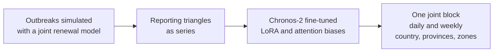

# Fine-tuned foundation

We fine-tune the Chronos-2 forecasting model on simulated outbreaks so that it can nowcast from a reporting triangle laid out as series.
The fine-tuned model forecasts daily and weekly series in one joint block, for the country, the provinces and the health zones.
We compare it with `randomwalknowcast` from [nowcastbaselines](https://samabbott.co.uk/bdbv-hub-modelling/nowcastbaselines/), our JAX port of baselinenowcast with a random walk on top, which we develop as part of the paper.
This section is for readers of the paper and for anyone who wants to use the fine-tuned checkpoints on their own data.

The outbreaks come from one PyRenew model, from latent infections to reported counts (`nowcastrenewal.simulation`), with each simulation's settings drawn from a grid (`nowcastfoundation.simulator`).

## Where to start

- To use a checkpoint, start with [Using the fine-tuned model](../methods/finetuned-chronos.md).
- To reproduce the simulation, training and scoring, start with the [workflow](https://github.com/seabbs/bdbv-hub-modelling/blob/main/workflow/README.md), one Snakemake target per step.

## In this section

- [Paper](../paper.md): the main text and the supporting information, which hold the methods (the simulation grid, the training and the evaluation) and the results.
- [Using the fine-tuned model](../methods/finetuned-chronos.md): loading a released checkpoint and nowcasting your own reporting triangle.
- [German nowcast benchmark](../germany.md): the paper's retrospective case study.

The code is in [nowcastfoundation](../packages/index.md#nowcastfoundation), [nowcastrenewal](../packages/index.md#nowcastrenewal) and [nowcastbaselines](https://samabbott.co.uk/bdbv-hub-modelling/nowcastbaselines/).
How the hub submission uses these models is on [Foundation models](../methods/foundation.md) and [Baseline models](../methods/baselines.md), under Hub submission.

Next: [Paper](../paper.md).
