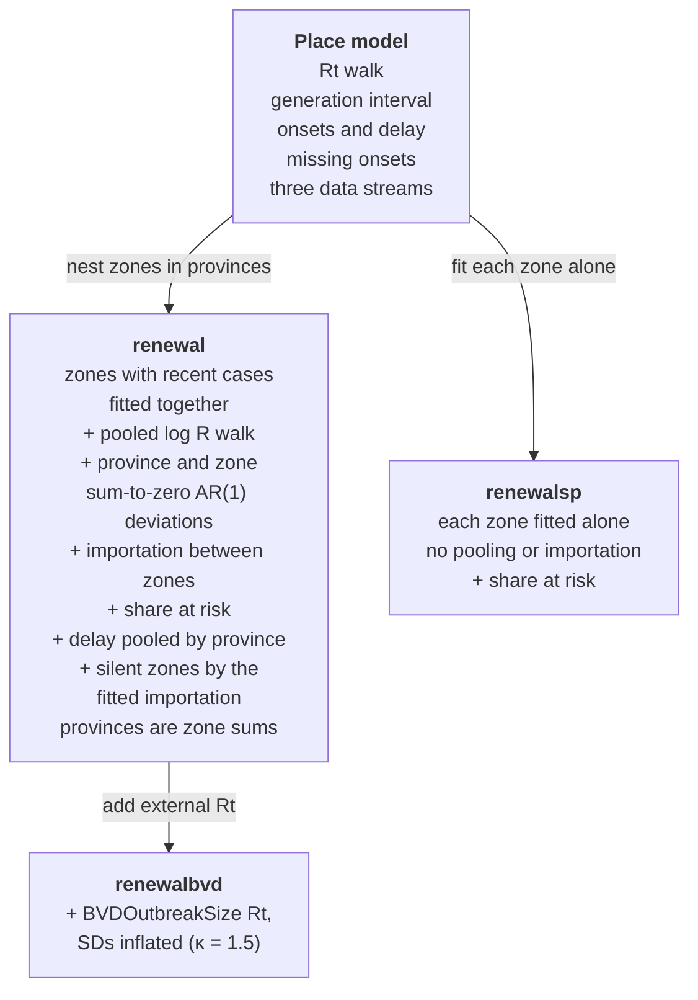

# Renewal models

The three renewal models, and what their fits give the site and the hub.
{ .page-subtitle }

`renewal` fits the health zones with recent cases together, nests them in their provinces, pools them and links them by importation.
`renewalbvd` is `renewal` with a down-weighted likelihood term on the Rt of BVDOutbreakSize.
`renewalsp` fits the same model to each health zone on its own, with no pooling or importation.
Their methods, equations, priors and limitations are in the paper's [supporting information](../paper/si.html#renewal-model).
How the models are built in code and sampled is on the [Implementation](implementation.md) page.

The zone fits are in [`zones.py`](https://github.com/seabbs/bdbv-hub-modelling/blob/main/packages/nowcastrenewal/src/nowcastrenewal/zones.py) and [`model/zones.py`](https://github.com/seabbs/bdbv-hub-modelling/blob/main/packages/nowcastrenewal/src/nowcastrenewal/model/zones.py).
`seabbs-renewal` submits the first of `renewalbvd`, `renewalsp`, `renewal`, `randomwalknowcast` and `randomwalk`, in that order, to pass its checks ([Submission workflow](../submission/workflow.md#renewal-chain)).
A release with national cases in no province stops the fit (`check_national`), since no release has had any (`data/national-coherence.csv`).

## Weekly Rt { #weekly-rt }

Each fit also gives the hub's `wk R_t` target, the weekly effective reproduction number by week of infection.
For place $p$ and week $w$ it is the daily effective Rt (Rt times the susceptible share) weighted by that day's infections,
$$R_{p,w} = \frac{\sum_{t \in w} I_p(t) R^{\text{eff}}_p(t)}{\sum_{t \in w} I_p(t)}.$$
A province above fitted zones and the country pool their fitted places in the same way, weighting each by $\sum_{t \in w} I_p(t)$, draw by draw.
Rt is given for the fitted zones, the provinces above them and the country.
A zone is fitted if it had a case in the 9 weeks to the cut-off, the random walks' walk window ([Baseline models](baselines.md)).
Places outside the fit have no Rt and add nothing to their province or the country.
We submit every location in `rt.csv.gz`, for the week before the reference date and the reference week.
Fits of zones on their own (`renewalsp`) pair draws by index, as their trajectories do.
The quantiles are taken over every posterior draw, not the 100 trajectories, and weeks after the data take the forecast Rt.
The fit directory holds them as `rt.csv.gz` (`location`, `target_end_date`, `output_type_id`, `value`).
This Rt is estimated from the hub's onsets, including its imputed onsets, so it is likely to react more slowly than transmission ([hub issue 61](https://github.com/InsightNet-US/BDBV-Modeling-Hub/issues/61)).

## Health zones

Zones do not enter the national value.
`renewal` and `renewalbvd` forecast the zones themselves, and their provinces are the zone sums.
`randomwalk` and `randomwalknowcast` forecast each zone from its own data ([supporting information](../paper/si.html#baselines)).
The foundation models take their zones straight from their joint block, as their provinces and country, so their zones need not sum to the provinces either ([Foundation models](foundation.md#health-zones)).
`renewalsp` fits each zone on its own, and its provinces are the zone sums too.
The stored fits, the scores, the site and the submission all read these zone samples.
