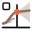

# Packages

The code behind the three projects, as seven packages and a workflow.
{ .page-subtitle }

This page is for anyone using or changing the code.
nowcastutils, nowcasteval and nowcastbaselines each have a docs site: getting started, how to, the API reference and how the package is used in the workflow.
The API of the others is in the [API reference](../reference/index.md), and each package's README on GitHub lists its modules and where to start.

## Where to start

- To install and make one forecast, start with [Setup](../setup.md), then [Getting started](../getting-started.ipynb).
- To run the simulation, fine-tuning, scoring and paper, start with the [workflow](https://github.com/seabbs/bdbv-hub-modelling/blob/main/workflow/README.md).

## The packages

| | Package | What it holds | Code and API |
|---|---|---|---|
| { width="40" height="40" } | [**nowcastutils**](../nowcastutils/){ #nowcastutils } | Releases, snapshots, location hierarchies, the forecast task and sample trajectories | [Docs site](../nowcastutils/), [API](../nowcastutils/reference/) |
| { width="40" height="40" } | [**nowcasteval**](../nowcasteval/){ #nowcasteval } | Scores (WIS and its parts, CRPS, energy), backtests and trajectory pairing | [Docs site](../nowcasteval/), [API](../nowcasteval/reference/) |
| { width="40" height="40" } | **nowcastworkflow**{ #nowcastworkflow } | The Snakemake workflow in `workflow/`, its rules and the `flowlib` helpers they call; not an installed package | [Workflow](https://github.com/seabbs/bdbv-hub-modelling/blob/main/workflow/README.md) |
| { width="40" height="40" } | [**nowcastbaselines**](../nowcastbaselines/){ #nowcastbaselines } | The random walk and the random walk nowcast | [Docs site](../nowcastbaselines/), [API](../nowcastbaselines/reference/) |
| { width="40" height="40" } | **nowcastfoundation**{ #nowcastfoundation } | Foundation model forecasts, the simulation grid and fine-tuning on simulated outbreaks | [Using the fine-tuned model](../methods/finetuned-chronos.md), [README](https://github.com/seabbs/bdbv-hub-modelling/blob/main/packages/nowcastfoundation/README.md) |
| { width="40" height="40" } | **nowcastrenewal**{ #nowcastrenewal } | The renewal models, their BVDOutbreakSize inputs and the joint model that simulates outbreaks | [Renewal model](../reference/model.md), [Methods](../renewal/methods.md), [README](https://github.com/seabbs/bdbv-hub-modelling/blob/main/packages/nowcastrenewal/README.md) |
| { width="40" height="40" } | **nowcastbdbv**{ #nowcastbdbv } | The BDBV outbreak as a case study: the hub's data streams, health zones and delays. | [API](../reference/index.md), [README](https://github.com/seabbs/bdbv-hub-modelling/blob/main/packages/nowcastbdbv/README.md) |
| { width="40" height="40" } | **nowcastgermany**{ #nowcastgermany } | The German hospitalisation nowcasting hub as a case study: its reporting triangles and forecasts as tasks | [API](../reference/index.md), [README](https://github.com/seabbs/bdbv-hub-modelling/blob/main/packages/nowcastgermany/README.md) |
| { width="40" height="40" } | **bdbvhub**{ #bdbvhub } | Hub formatting, checks, the fit store and the submission | [Submission](../reference/submission.md), [README](https://github.com/seabbs/bdbv-hub-modelling/blob/main/packages/bdbvhub/README.md) |

## Next

- [Setup](../setup.md): install the package and the hub data.
- [Getting started](../getting-started.ipynb): one forecast end to end.
- [Development](../development/contributing.md): contributing, adding a model and the command line.
- [Citation and licence](../citation.md).

Next: [Setup](../setup.md).
