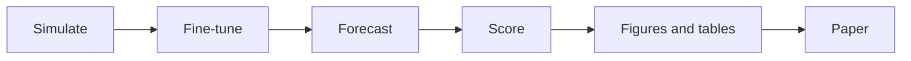

# Paper

A paper on fine-tuning Chronos-2 on simulated outbreaks for nowcasting.
This page links to the rendered paper and to how it is reproduced.

## Where to start

- To read it, start with the [main text](paper/main.html), then the [supporting information](paper/si.html). Both have PDFs.
- To reproduce it, start with [Reproducing the paper](https://github.com/seabbs/bdbv-hub-modelling/blob/main/paper/README.md): the workflow, its targets and how the held-out data are protected.



??? note "Reproduce it"
    From `paper/`:

    ```sh
    task pipeline:dev      # the development run, without the held-out data
    task pipeline:paper    # the paper run, with the held-out data
    task render            # the paper as HTML and PDF from the last run
    ```

    This site shows the development run.
    Figures from a study without its real data yet are marked as illustrative, dummy data.

Each step is a section of the [workflow](https://github.com/seabbs/bdbv-hub-modelling/blob/main/workflow/README.md).

Next: [Using the fine-tuned model](methods/finetuned-chronos.md).
