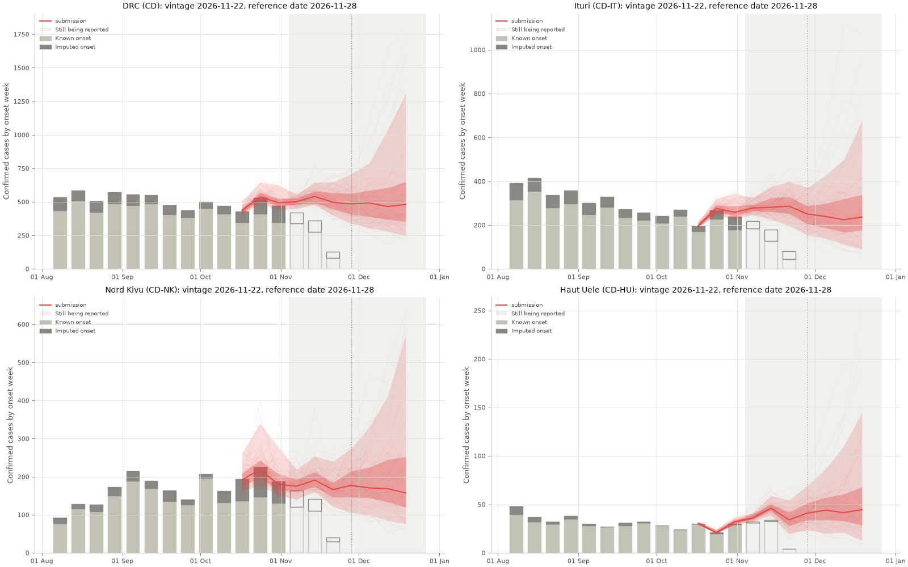
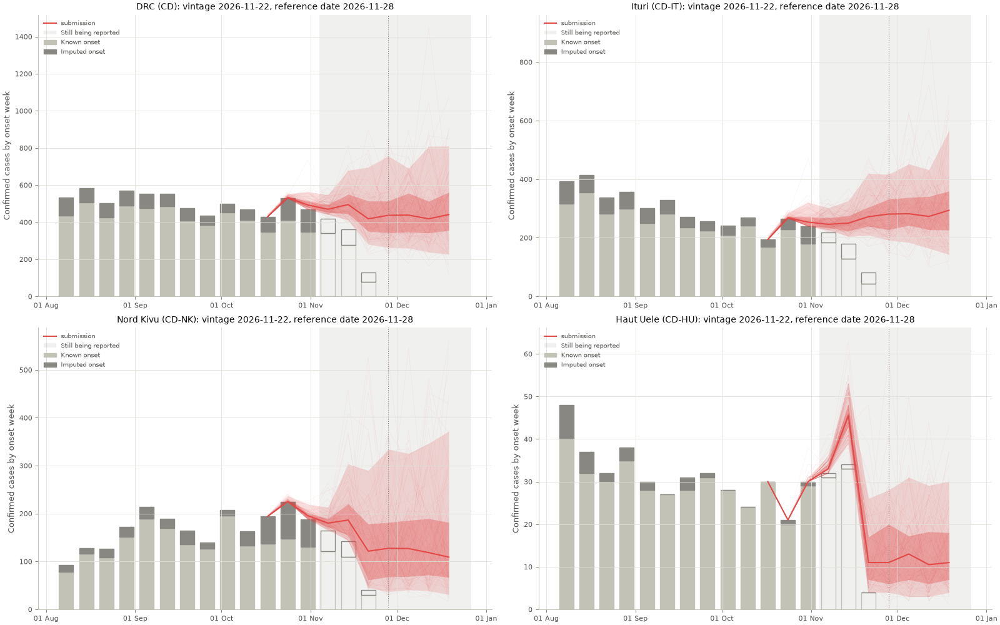

# Round 2026-11-28

Nowcasts and forecasts submitted to the BDBV Modeling Hub for the round with reference date 2026-11-28.
{ .page-subtitle }

Data vintage (`as_of`): 2026-11-22.

=== "seabbs-renewal"

    | | |
    | --- | --- |
    | Status | submitted |
    | Produced by | BVDOutbreakSize-informed renewal model |
    | Model | renewalbvd (`bvd`) |
    | Gate status | warn |
    | Hub pull request | [link](https://github.com/InsightNet-US/BDBV-Modeling-Hub/pull/154) |
    | Workflow run | [link](https://github.com/seabbs/bdbv-hub-modelling/actions/runs/45492920880) |
    | Commit | [`31182f5`](https://github.com/seabbs/bdbv-hub-modelling/commit/31182f572a80ad51b400456eea8a00d6ce286eb6) |

    The BVDOutbreakSize-informed renewal model cleared every check, with warnings.

    

    Bars are the published counts by onset week in the data used. Lines and bands are the submitted median, sample trajectories and 50% and 90% intervals.

    **National**

    | week ending | median | 50% interval | 90% interval |
    | --- | --- | --- | --- |
    | 2026-10-17 | 435 | 415 to 452 | 405 to 505 |
    | 2026-10-24 | 538 | 514 to 566 | 488 to 645 |
    | 2026-10-31 | 493 | 468 to 524 | 439 to 623 |
    | 2026-11-07 | 501 | 480 to 528 | 451 to 555 |
    | 2026-11-14 | 540 | 493 to 582 | 479 to 645 |
    | 2026-11-21 | 473 | 407 to 541 | 1 to 639 |
    | 2026-11-28 | 449 | 356 to 545 | 1 to 695 |
    | 2026-12-05 | 492 | 389 to 586 | 304 to 789 |
    | 2026-12-12 | 464 | 370 to 606 | 282 to 1036 |
    | 2026-12-19 | 480 | 353 to 649 | 246 to 1307 |

    **Checks**

    | check | status | summary |
    | --- | --- | --- |
    | schema | pass | format matches the hub's round |
    | values | pass | all values finite and non-negative |
    | rt | pass | wk R_t: 128 location-weeks of quantiles |
    | samples | pass | 100 full trajectories per location |
    | coverage | pass | 546 locations, weeks 2026-11-07 to 2026-12-19 |
    | zones | pass | 519 zones in 26 provinces |
    | national_sum | pass | CD is the exact sum (national.json: 26 modelled provinces) |
    | bounds | warn | CD-NK-29: 95th centile 128 is 5.13 times the bound base 25 |
    | plausible | pass | within range of the recent data |
    | growth | pass | forecast growth within the cap |
    | observed | pass | close to observed (2026-11-22) |
    | baseline | warn | CD-HU-02: median 31.5 against random walk baseline 3 over 2026-12-05 to 2026-12-19 (ratio 4.56) (and 1 more) |
    | previous | warn | CD-HU-13: median 49 against last week's submission 0 over 2026-10-17 to 2026-12-12 (ratio 10.8) (and 1 more) |

    **Candidates**

    | step | outcome | why |
    | --- | --- | --- |
    | BVDOutbreakSize-informed renewal model | submitted |  |
=== "seabbs-rwnowcast"

    | | |
    | --- | --- |
    | Status | submitted |
    | Produced by | random walk on a nowcast |
    | Model | randomwalknowcast (`randomwalknowcast`) |
    | Gate status | warn |
    | Hub pull request | [link](https://github.com/InsightNet-US/BDBV-Modeling-Hub/pull/153) |
    | Workflow run | [link](https://github.com/seabbs/bdbv-hub-modelling/actions/runs/45492920880) |
    | Commit | [`31182f5`](https://github.com/seabbs/bdbv-hub-modelling/commit/31182f572a80ad51b400456eea8a00d6ce286eb6) |

    The random walk on a nowcast cleared every check, with warnings.

    

    Bars are the published counts by onset week in the data used. Lines and bands are the submitted median, sample trajectories and 50% and 90% intervals.

    **National**

    | week ending | median | 50% interval | 90% interval |
    | --- | --- | --- | --- |
    | 2026-10-17 | 429 | 429 to 430 | 429 to 441 |
    | 2026-10-24 | 532 | 529 to 538 | 528 to 552 |
    | 2026-10-31 | 492 | 480 to 512 | 468 to 563 |
    | 2026-11-07 | 470 | 452 to 494 | 441 to 547 |
    | 2026-11-14 | 495 | 446 to 551 | 411 to 679 |
    | 2026-11-21 | 418 | 351 to 514 | 280 to 696 |
    | 2026-11-28 | 437 | 343 to 514 | 263 to 756 |
    | 2026-12-05 | 438 | 346 to 556 | 260 to 690 |
    | 2026-12-12 | 418 | 342 to 513 | 239 to 808 |
    | 2026-12-19 | 441 | 356 to 562 | 228 to 810 |

    **Checks**

    | check | status | summary |
    | --- | --- | --- |
    | schema | pass | format matches the hub's round |
    | values | pass | all values finite and non-negative |
    | rt | skip | no wk R_t rows |
    | samples | pass | 100 full trajectories per location |
    | coverage | pass | 546 locations, weeks 2026-11-07 to 2026-12-19 |
    | zones | warn | 519 zones; 5875 province sample-weeks differ from the sum of their zones |
    | national_sum | pass | CD is the exact sum (national.json: 26 modelled provinces) |
    | bounds | warn | CD-IT-26: 95th centile 1.35e+03 is 17.1 times the bound base 79 |
    | plausible | warn | CD-IT-26 2026-12-05: 97.5% quantile 1.55e+03 is over 15 times 92.9, the upper limit of the recent maximum 74 (and 2 more) |
    | growth | pass | forecast growth within the cap |
    | observed | pass | close to observed (2026-11-22) |
    | baseline | skip | this is the baseline |
    | previous | warn | CD-BU: median 7 against last week's submission 0 over 2026-10-17 to 2026-12-12 (ratio 2.4) (and 9 more) |

    **Candidates**

    | step | outcome | why |
    | --- | --- | --- |
    | random walk on a nowcast | submitted |  |
