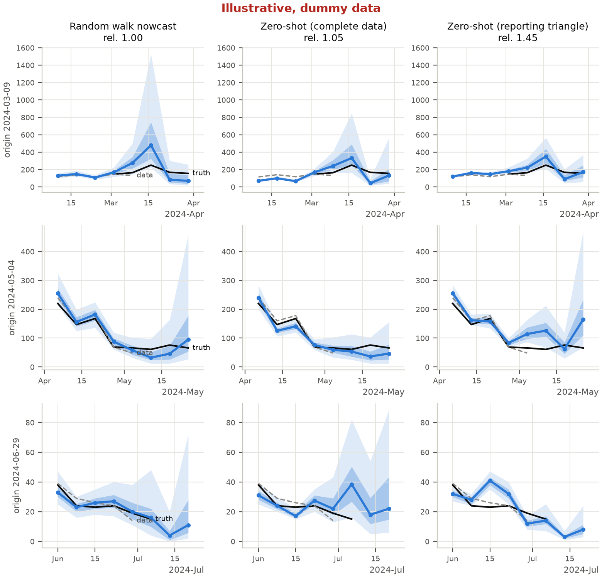
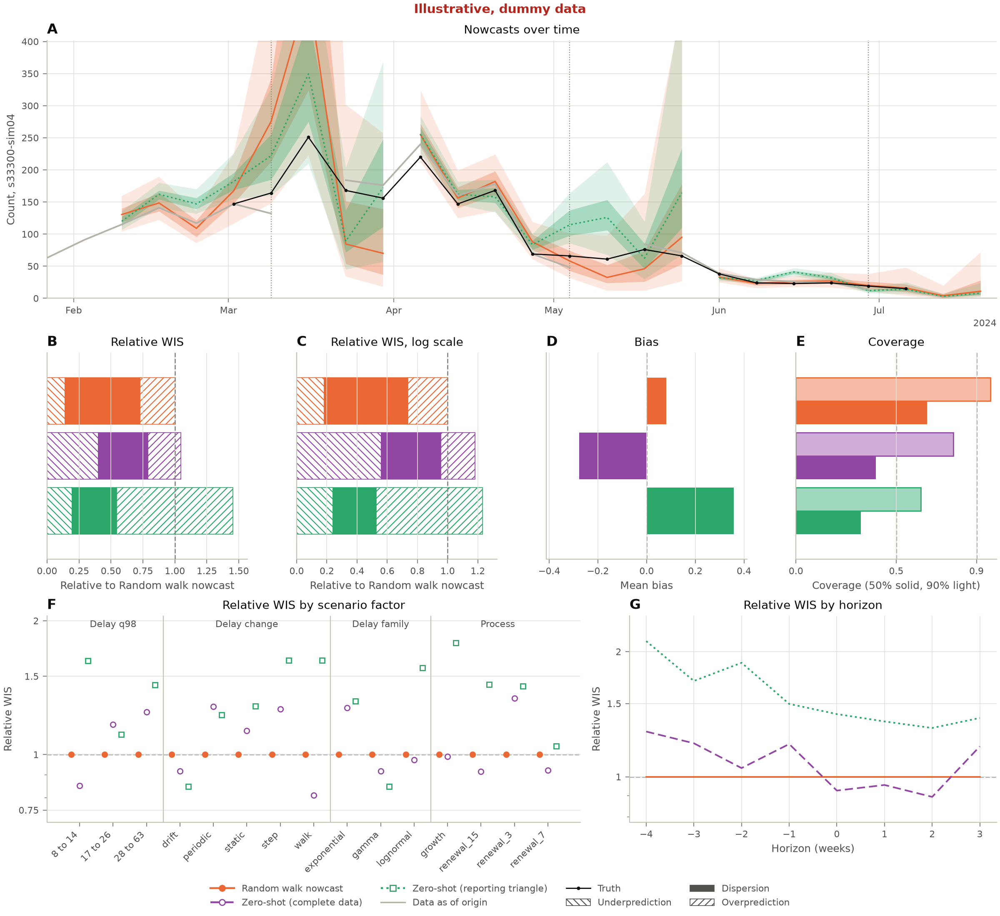
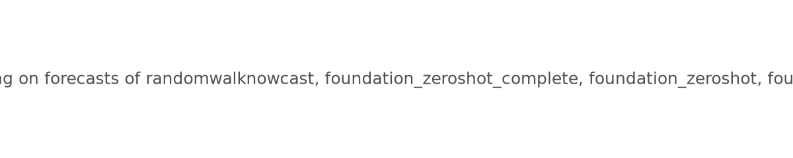
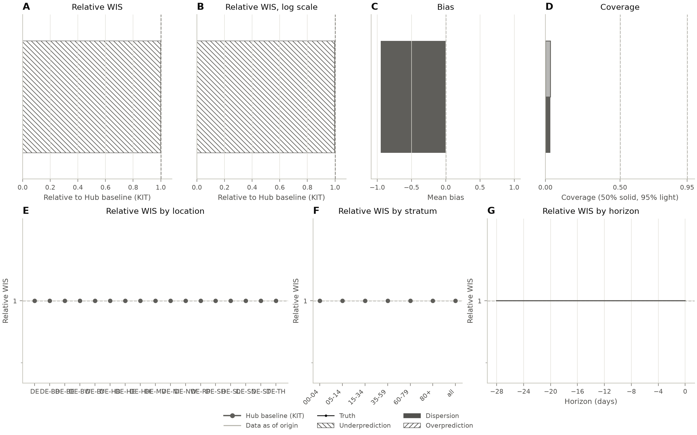

<!--
Each top-level bullet is one paragraph, with 2–3 supporting points.
-->

## Author summary

Forecasts of infectious disease cases help public health agencies plan their response.
Recent counts are incomplete because cases take time to be reported.
Nowcasts estimate the cases not yet reported.
General forecasting models trained on many unrelated time series forecast well with no setup.
However, we do not think they were trained on reporting delays, so they may mistake incomplete recent counts for a falling outbreak.
Nowcasting models do account for delays, but simple ones forecast poorly and complex ones need specialist knowledge to set up for each setting.
We taught one of these general models, Chronos-2, about reporting delays by training it further on simulated outbreaks.
The simulations follow an established nowcasting model.
We tested the model on simulated outbreaks, on past COVID-19 hospital admissions in Germany, and in real time during an Ebola outbreak in the Democratic Republic of the Congo.
It [did better than / matched] the unmodified model, a simple nowcasting method and other teams' models.
Models taught this way could be baselines for teams and hubs that forecast infectious disease.
Teams without the capacity to set up specialist models could also use them directly, as they adapt to new settings better than simple nowcasting methods.

## Introduction

::: {.callout-note title="Plan"}
- **The gap.**
  - Infectious disease forecasting is being increasingly used to provide situational awareness for public health.
  - Both in infectious disease forecasting, and more widely, modern machine learning methods including neural networks are becoming increasingly popular.
    In particular, foundation time series models which are neaural networks trained on many time series have been shown to outperform traditional methods in many settings.
    However, these methods are not generally specifically designed to deal with, or to make use of, the biases and delays common to infectious disease surveillance data.
  - Nowcasting models have become increasingly popular as a method to make use of these reporting delays in order to improve forecasts of what will eventually be reported.
  - Generally, these methods are either relatively simple [@hohle; @Johnson2025], complex and customised for a given setting [@epinowcast; @Wolkfram2023], or are developed in ad-hoc fashion for a given target [@bdbv_modeling_hub_2026].
  - If these methods have forecasting support it is generally relatively limited or difficult to make performant without expert knowledge of the target and the reporting system.
  - Methods that fused the frontier forecasting performance of foundation time-series models with the nowcasting performance of domain-specific methods without requiring specialisit knowledge to configure could improve infectious disease forecasts and more generally provide a case study for incorporating domain knowledge into foundation models.
  - Key references: [@hohle; @Johnson2025; @reichCollaborativeHubsMaking2022].

- **Context.** Foundation time series models and their use in infectious disease forecasting.
  - Time series foundation models forecast new series with no training on them.
  - They are typically developed using complex, high parameter neural networks, trained on many time series, and are able to learn general patterns in time series data.
  - Recent examples include Chronos-2 [@Ansari2025], TimesFM [@Das2024a] and Moirai [@Woo2024] which have all been shown to peroform well on a wide range of forecasting tasks.
  - They are now used widely in operational forecast hubs, for influenza, COVID-19 and RSV, mostly without modification (zero-shot) [@flusight_hub; @placeholder; @respicast_si_hub; @Ansari2025; @Das2024a; @Woo2024].
  - Most of the currently used foundation modles come with tools that allow them to be fine-tuned on new data.
  - This is a process where the weights of the model are modified to better fit the new data, usually using Low-Rank Adaptation (LoRA) or similar methods, which allow the model to be adapted to new data without requiring full retraining.
  - Some recent infectious disease forecasting models fine-tune a foundation model on real surveillance data [@dhauser_fluchronos; @fluxengine_atlas].
  - Several existing methods incorporate domain knowledge using simulated data but all of these approach custom neural network architectures [@Dudley2026; @umass_axial].
  - Outside of infectious disease forecasting fine tuning using domain-specific synthetic data has been shown to improve performance in other domains, including weather forecasting [@Dooley2023] and financial time series [@Muller2022].
  - As well as fine tuning, foundation time series models can be adapted with small changes to their architecture.
    One such change adds learned biases to the attention scores, so the model knows which series are related, such as a count and its reporting delays, or a place and the region that contains it [@Woo2024; @Yang2022].
  - Key references: [@mcgough2020nowcasting; @gunther2021nowcasting; @Wolffram2023; @Ansari2024; @Das2024a; @Woo2024; @Rasul2023; @Garza2023; @Aksu2024; @Shchur2025; @Kalahasti2026; @Dudley2025].

- **Context 2** Nowcasting methods and avilable models
  - Nowcasting methods estimate what will eventually be reported for recent dates, using the reporting triangle of counts by reference date and reporting delay [@hohle; @Wolffram2023].
  - To use simulated data for fine-tuning, we need a method that can also act as a generative model of how outbreaks are reported.
  - Chain ladder methods scale up partial counts by the share historically reported at each delay [@Johnson2025].
    They are fast and transparent, but have no model of incidence, so they cannot simulate new outbreaks.
  - Regression methods fit the reporting triangle as a smooth surface over reference date and delay [@vandeKassteele2019; @Schneble2021; @bastos; @Mellor2025].
    They describe the observed data well but do not constrain the delay distribution or include mechanisms such as transmission, so they give no clear process to simulate from.
  - Conditional generative models first model total counts and then split them across delays [@hohle; @Stoner2020; @Stoner2023; @Seaman2022].
    This separates variability in incidence from variability in reporting.
    However, there is no general software framework for them, and they have not been extended to the wide range of reporting patterns seen in practice, such as changing delays, report-day effects and mixed reporting cadences.
  - Marginal generative models specify expected counts by reference date and spread them across delays, treating each cell of the reporting triangle as a separate draw [@mcgough2020nowcasting; @gunther2021nowcasting; @lison2024; @abbottepinowcast].
    Run forward, they simulate how outbreaks are reported, and can include a renewal process, parametric and time-varying delays, report-day effects and pooling across places and age groups [@lison2024; @abbottepinowcast; @Bergstrom2022].
  - epinowcast is a community-developed software framework for marginal generative nowcasting models [@abbottepinowcast].
    It is flexible, and supports a wide range of reporting patterns, including changing delays, report-day effects, hierarchical pooling, missing reference dates and user-defined reporting schedules.
    It has been used in a wide range of applications, including nowcasting COVID-19 hospitalisations in the German nowcast hub [@Wolffram2023], and as a check in nowcasts of mpox and norovirus in England [@Overton2023-dk; @Mellor2025].
    The same form of model has been used to nowcast the effective reproduction number from line list data [@lison2024].
    This makes it a natural basis for simulating training data, and our simulations follow its structure.
  - PyRenew is a Python framework, developed and used at the US CDC, for building renewal models of infectious disease from modular components, such as infection processes, delays and observation models, using JAX and NumPyro [@pyrenew; @Phan2019].
    It was developed to fit models similar to those in EpiNow2 and to the generative process in epinowcast to multiple data streams across many locations [@EpiNow2; @abbottepinowcast].
    However, it has no marginal nowcasting model, and does not have delays that change over time or Dirichlet-multinomial reporting noise.

- **What we did.**
  - We fine-tuned Chronos-2, a general time series foundation model, on infectious disease surveillance data simulated using the epinowcast nowcasting framework.
  - epinowcast is written in R and Stan [@RCoreTeam; @Carpenter2017], while Chronos-2 is written in Python.
    We ported the epinowcast model to Python on top of PyRenew, reusing its components and adding components where it had none, such as delays that change over time.
  - We validated the port by submitting renewal models built on it to the Ebola forecasting hub in real time [@bdbv_modeling_hub_2026].
    One of these used the posterior reproduction number estimates of BVDOutbreakSize, our model of the outbreak's size, to inform its own [@BVDOutbreakSize] (SI, Renewal model).
  - We gave the model the reporting triangle as one series per place and reporting delay.
    We added learned attention biases so it can tell which delay series belong to which place, and which places sit within which regions.
  - We developed the settings for the simulated data based on our past experience of infectious disease modelling including in the COVID-19 pandmeic [@Wolffram2023], the 2023 Mpox outbreak [@Overton2023-dk], and based on the early data available for the 2025 Ebola outbreak in the Democratic Republic of the Congo [@bdbv_modeling_hub_2026].
  - We adapted a recently developed baseline nowcasting method, baselinenowcast, to also produce forecasts as a baseline for comparison, and to work on sparse data [@Johnson2025] (SI, Baselines).
    We also submitted it to the Ebola forecasting hub in real time.
  - We first evaluated these models on held-out simulations.
  - To assess real world performance we compared our methods retrospective nowcasts to those from models from the the German COVID-19 hospitalisation nowcast hub and initially retrospective and then prospective nowcasts and forecasts to those from models from Ebola forecasting hub.
  - We explored a range of senesitivity analyses to assess the impact of different design choices on model performance.
  - These included: assessing the impact of using a baseline nowcast as input to the foundation model, fine-tuning on real data, removing the attention biases and lag series, and comparing different lag count rules and block structures.
  - We aim to demonstrate the potential of foundation time series models fine-tuned on domain-specific synthetic data to improve infectious disease nowcasting and forecasting, and to provide a case study for incorporating domain knowledge into foundation models more generally.
  - Key references: [@Ansari2025; @Johnson2025].
:::

## Methods

### Data

::: {.callout-note title="Plan"}
- We used the German COVID-19 hospitalisation nowcast hub's reporting triangle, nationally, by state and by age group.
- We used the Ebola forecasting hub's weekly confirmed cases by symptom onset, with every release, by country, province and health zone.
- We exclude a first release that reports cumulative counts rather than new reports, as BDBV's 18 August release does, because it does not reflect reporting.
- Key references: [@Wolffram2023; @hospitalization_nowcast_hub_2025; @bdbv_modeling_hub_2026; @MacNeil2010].
:::

### Baselines

::: {.callout-note title="Plan"}
- We compare with `randomwalk`, a random walk with no delay adjustment, and `randomwalknowcast`, a random walk nowcast.
- The SI describes both in full.
- Key references: [@Johnson2025].
:::

### Foundation model setup and fine-tuning

::: {.callout-note title="Plan"}
- We give Chronos-2 the reporting triangle as series, one per place and reporting delay, each missing until reported (Figure 1B).
- Chronos-2 is built from attention layers, in which each series updates what it has learned as a weighted mix of the other series, with more weight on those it finds relevant.
- Without more information, the model has no marker of which delay series belong to which place's count.
- We add learned attention biases that nudge these weights by how two series are related (the same place, or a place and its parent or child), building on Moirai's any-variate attention and TableFormer's relation biases [@Woo2024; @Yang2022] (SI).
- A third each of the training blocks with places have a country equal to, above or later than the sum of its places.
- We fine-tune base Chronos-2 on synthetic data on one machine, with its default LoRA recipe.
- LoRA trains a small update to about 1% of the model's weights rather than retraining them all, so fine-tuning starts from the original model (SI).
- Zero-shot Chronos-2 on the reporting triangle gets the same input as the fine-tuned model for each task, the same lag series, lag count, aggregate rows and layout, so only the weights differ.
- We train on  simulations drawn from the grid, each drawing its settings independently.
- The learning rate falls linearly to zero over these simulations.
- Each simulation gives up to 14 training blocks.
- A block is daily, 3-day or weekly.
- A daily block can also have one extra row per place, with its weekly or 3-day totals or its rolling 7-day or 3-day sums.
- In 30% of blocks the releases start late, so the first release fills in earlier onsets, as the Ebola hub's first release did.
- 5% of blocks have no lag series, as when only the latest data are at hand.
- Most blocks are multivariate, and one in five blocks from outbreaks with more than one stratum is univariate.
- We save checkpoints at  simulations.
- At each checkpoint we check that the 7-day forecasts agree with the sums of the daily forecasts and are no rougher than the truth (SI).
- We report the final checkpoint, where the learning rate reaches zero, and select no checkpoint on real data.
- Chronos-2 forecasts the country, provinces and health zones as separate series in one joint block.
- A system too large for one block is cut into views, in training and at forecast time alike.
- Blocks are limited to what fits in the memory of our available GPUs, and we made several approximations to fit within this (SI, Fitting in GPU memory).
- Each view is a subtree, such as a province with its zones, or the aggregated top of the country and its provinces (SI).
- For the Ebola case study, the fine-tuned model makes two forecasts at each nowcast date.
- One is a joint block of the country, all provinces and the active health zones.
- A zone is active with at least 20 cases in the last 8 weeks and at least 1 case in the last 4 weeks, as reported by the nowcast date.
- The other is one block per province, of the province and all its zones, cut into views as in training when over the block limit.
- The country, provinces and active zones take their forecast from the joint block, and every other zone from its province's block (SI).
- At forecast time the number of lag rows, $D$, is set from the data by default, for the zero-shot and fine-tuned models alike (SI).
- Each onset day first published after releases began settles at the first lag at which its reported count reaches 98% of its latest count.
- $D$ is one more than the 98th percentile of these settling lags, using only days seen for at least $1.5D$ lags.
- With no such day, $D$ is the release history.
- A study can set a fixed $D$ instead.
- Training blocks use the same rule for $D$ in 90% of blocks and $D$ scaled by a factor drawn from Normal(1, 0.05) in the other 10%, so the model is robust to $D$ set slightly differently.
- We compare the fine-tuned model with zero-shot Chronos-2 and with Chronos-2 given only complete data.
- We plot each checkpoint's scores, with both as reference lines (SI).
- Figure 1 shows the simulation, the ragged series, training and forecasting.
- TODO: replace the SI's dashboard screenshot with a static render of the finished run from the workflow.
- Key references: [@Ansari2025; @Ansari2024; @Hu2021; @Das2024b].
:::

![The fine-tuning pipeline.
(A) The assumptions in the simulations: a latent process gives expected onsets by stratum, which a reporting delay that may drift or step, report-day effects and count noise turn into a reporting triangle.
(B) The reporting triangle laid out as ragged series for Chronos-2: each place has a target complete up to E and one series per lag, missing until reported (daily lag series fill only on release days), and counts reported after E enter as known-future inputs.
Group attention has learned biases for a series attending to the other series of its place, its count and lags, and between a place and its parent or children, as in Moirai's any-variate attention [@Woo2024], while every place's series sit in one group.
The grid shows group attention at one step for a country C and places A and B, each with a count and two lag series, with each cell shaded by its relation (same place: a place's count series and its lag series).
Beside it, one place's daily rows carry a weekly total row, missing until the last day of each week.
(C) Training blocks and LoRA fine-tuning, and why it is fast: blocks cut from simulated release histories at random cut-offs are scored against the final simulated counts, and only rank-8 adapters, about 1% of the weights, and the attention biases are trained.
(D) Forecasting with the fine-tuned model: one forward pass gives quantiles for each step, and each draw reads them at a uniform level u.](figures/fig1-pipeline.svg){#fig-pipeline}

### Synthetic data generation

::: {.callout-note title="Plan"}
- **What the grid simulates.**
  - We simulate outbreaks in five layers, each described with its figure and sampling distributions in the SI.
  - In layer 1 we simulate infections by a renewal process with susceptible depletion in each place and age group, with R(t) following one of several transmission paths, shifts in R(t), immune escape, imports and mixing between strata.
  - In layer 2 we observe infections as reference events after a delay such as incubation, ascertain a share of them and add NB1 or Poisson noise.
  - In layer 3 we report them after a reporting delay that is static or changes over time, as epinowcast's observation model does.
  - In layer 4 we add the reporting system: report days and weekday effects, half with structured patterns such as a weekend dip, backlogs, outages, revisions, so a release can exceed the final count, and the release cadence.
  - In layer 5 we set the strata and aggregation: places and age groups and how they nest, how places interact, how settings vary across strata, and aggregates that are exact sums of their strata or do not add up.
  - Layer 1 is the epidemic setting, and layers 2 to 5 are what fine-tuning teaches.
  - The workflow simulates outbreaks from the grid's config and writes every summary and figure, so a change to the grid regenerates them.
- **What the summaries show.**
  - We compare the grid's summary statistics with the German development half and with published ranges for other diseases.
  - Figure (planned): "The simulation grid against real outbreaks. (A) A few example simulations across settings (endemic, early outbreak and established epidemic), each with its final counts and the counts reported by the nowcast date, and strips of R(t) with effective R and of the mean reporting delay. (B) The share of simulated outbreaks with 0, 1 and 2 or more rises. (C) The share of training cut-offs in each epidemic phase (growing, stable, declining and turning). (D) Outbreak sizes. (E) Growth rates. (F) Reporting delays. (G) Coverage: for R and effective R, the generation time mean, the infection-to-reference delay mean, the mean reporting delay and the growth rate, the grid's median and 5 to 95% range beside published ranges for influenza, COVID-19, Ebola, mpox, cholera, measles and dengue and the German development half's values. Panels B to F compare the simulations with the German development half and published ranges for other diseases where values exist."
  - We give the published ranges with their sources in a table in the SI.
- Key references: [@abbottepinowcast; @lison2024; @Park2024; @Ansari2024; @Dooley2023; @Muller2022; @Hollmann2025].
:::

### Correlated trajectories

- We pair the province draws of `randomwalk` and `randomwalknowcast` within each week with a rolling Gaussian copula, so their national forecast, the per-sample sum of the provinces, is not too narrow, while each cell keeps its own draws (SI).
- The hub does not require coherence across levels, so this is our choice for the walks.
  Chronos-2 submits its joint block's own national forecast.

We score the national sum and the provinces by the CRPS and 90% coverage.
We also report the energy score [@Gneiting2008], which is proper for joint forecasts [@gneitingStrictlyProperScoring2007] and has been used for epidemic trajectories from forecast hubs [@Bay2026], but discriminates poorly between dependence structures [@Pinson2013].

### Evaluation on held-out synthetic data

::: {.callout-note title="Plan"}
- We held out a test set of simulations from development, and monitored training on a separate validation set (SI).
- The fine-tune never trained on the held-out set's seeds (SI).
- We set each tuned choice on development data, apart from every scored set (SI).
- We score each model's quantiles with WIS and log-scale WIS, bias, and 50% and 90% coverage (95% for Germany, whose hub quantiles have no 5% or 95% level), relative to `randomwalknowcast`, and split WIS into dispersion, overprediction and underprediction [@bracherEvaluatingEpidemicForecasts2021].
- In the SI we also score samples with the fair CRPS and the fair energy score, which correct for the number of samples, so forecasts with different numbers of samples, ours and the hub teams', compare fairly [@Ferro2014; @Zamo2018; @zanetta_scoringrules_2024].
- We score against the data as reported $T$ days later, with $T$ each outbreak's 98% reporting delay.
- Key references: [@bracherEvaluatingEpidemicForecasts2021; @Bosse2023-sx; @gneitingStrictlyProperScoring2007; @gneitingProbabilisticForecastsCalibration2007; @sherrattPredictivePerformanceMultimodel2023].
:::

### Case study 1: German nowcast hub

::: {.callout-note title="Plan"}
- We compare with the hub's models, relative to the hub's baseline, and evaluate as the hub did.
- We score quantile forecasts with WIS, split into its three components [@bracherEvaluatingEpidemicForecasts2021], and log-scale WIS, bias, and coverage, against the data as reported 40 days later [@Wolffram2023].
- Our models see only reports made within 40 days of each reference date, so they forecast the count the truth holds.
- We score the hub's target, 7-day sums, ending on each day from the nowcast date to 28 days before it.
- We score only the hub's targets, and the SI adds our models' forecasts up to 4 weeks after the nowcast date.
- Each nowcast date is forecast once, so every 7-day sum comes from one forecast.
- Chronos-2 reads each day's 7-day sum from its own rolling-sum series, or sums its daily draws when it sees complete counts.
- The random walks forecast weeks ending on Saturdays, so they give only the 7-day sums that end on a Saturday.
- We score each model on its own quantiles at the hub's seven levels.
- As @Wolffram2023 did, we replace one team's erroneous values by its nowcast of the day before, and fill another's missing 10% quantiles from a normal through its 2.5% and 25% quantiles.
- Chronos-2 gives quantiles directly, which we interpolate linearly to the hub's levels, with no sampling.
- We score the random walks, which give samples, on the quantiles of 1,000 draws with common random numbers.
- One fine-tuned Chronos-2 model forecasts daily, 3-day and weekly data.
- For both case studies, we also score our models' daily counts directly from the daily rows, against `randomwalknowcast` (SI).
- We split the nowcast dates in half at 10 February 2022.
- We developed the setup on the first half and score the second half.
- Key references: [@Wolffram2023; @Johnson2025; @amaralPostprocessingWeightedCombination2025].
:::

### Case study 2: prospective submission to the Ebola forecasting hub

::: {.callout-note title="Plan"}
- We compare with the other submissions, relative to the hub's baseline.
- We score every hub round, all held out from model development.
- From the week of 23 November 2026 we scored each released checkpoint of the fine-tuned model on past hub rounds, to decide whether it could be submitted.
- These past rounds therefore informed that decision, and only rounds after the fine-tuned model's first submission are prospective for it.
- Every model, ours and the hub teams', forecasts some targets and places only, so we compare models on the forecasts they share and report the country, provinces and zones apart.
- We compare models by pairwise relative skill on the forecasts each pair shares, as scoringutils does, with WIS on the natural and log scales side by side [@Bosse2023-sx; @bosse2022scoringutils].
- We score only the hub's own targets and horizons.
- The hub's releases are few, weekly and begin with a backfill, so too few onset days have settled to estimate $D$.
- We therefore set $D = 42$ days at forecast time, as the random walk nowcast does, for the fine-tuned and zero-shot models alike.
- Scores of our submitted models are prospective, on the forecasts they submitted before each round closed.
- Scores of every other model of ours are retrospective, each forecasting a round from the last release before the round closed.
- We start forecasting at the first release with at least two usable releases up to it, so the random walk baselines can estimate their delay.
- We score quantile forecasts with WIS, split into its three components [@bracherEvaluatingEpidemicForecasts2021], and log-scale WIS, bias, and coverage, taking the hub teams' quantiles from their samples.
- We score each week against its count in the first release at least $T$ days after the week ends, with $T$ the 98% point of the hub data's reporting delay.
- By then nearly all of a week's cases are reported, so the truth changes little afterwards while every round can still be scored.
- $T$ is part of the scoring rule, not a choice tuned on the data.
- The SI compares the samples directly with the fair CRPS.
- We score Chronos-2 on its own quantiles, the random walks on 1,000 draws with common random numbers, and hub submissions on their 100 submitted trajectories.
- Quantiles from 100 draws are noisier than those from 1,000, so WIS is biased against the hub teams, and the fair CRPS in the SI checks this.
- The fine-tuned models use the final run's last checkpoint, at  simulations (``), trained on simulations only.
- Key references: [@bdbv_modeling_hub_2026; @Viboud2018; @funkAssessingPerformanceRealtime2019].
:::

### Sensitivity analyses

::: {.callout-note title="Plan"}
- In the baselinenowcast variant, we give the point nowcast of our baselinenowcast port to Chronos-2 as complete counts, both zero-shot and with the fine-tuned model, with no further fine-tuning.
- The fine-tuned model on this input shows what the synthetic data teach beyond the reporting delays.
- We fine-tune Chronos-2 on real data, the German development half and BDBV releases, and compare it with the model fine-tuned on simulations.
- We fine-tune one run without the attention biases and one without lag series, and compare each with the main run.
- We compare the lag count rule with a fixed cap of 4 weeks or 28 days.
- We compare the joint block with forecasting each level alone and with summing the lowest level.
- We compare the walks' rolling copula with no pairing, and score Chronos-2's submitted trajectories with its copula, with independent cells and comonotone.
- The SI gives each in full.
:::

### Implementation

::: {.callout-note title="Plan"}
- We used Python, PyTorch, chronos-forecasting, PEFT for LoRA, PyRenew and numpyro for simulation, and scoringrules for scoring, checked against scoringutils.
- A Snakemake workflow runs the evaluation from the raw data to every figure and table.
:::

## Results

::: {.callout-note title="Plan"}
Each section has a figure panel.
Every panel shows the same four models, named Random walk nowcast, Zero-shot (complete data), Zero-shot (reporting triangle) and Fine-tuned (reporting triangle) in every figure and table.
The case studies' score panels also show the hub's baseline, which their scores are relative to.
Zero-shot (complete data) has no lag series.
Every other comparison, and the hub teams beyond the hub's baseline, is in the SI.
Each panel shows:

- nowcasts over time at the national level (one outbreak for synthetic data), several origins overlaid, each over its horizons against the truth (ribbons) [@Wolffram2023];
- scores relative to the baseline (the random walk nowcast for synthetic data, the hub's baseline for each case study), with natural- and log-scale WIS stacked by its decomposition (fair CRPS of samples in the SI);
- bias;
- 50% and 90% coverage;
- score variation by location and horizon, supported by SI plots.
- for Germany, a dotted line marking the split between the development and scored parts, with scores split by part, each part a row on the score axis.

The plots in primarycensored-paper are a model for these.
Each section has two paragraphs, one on visual performance and one summarising scores.

Key references: the Methods references, with [@bracherEvaluatingEpidemicForecasts2021; @Bosse2023-sx] for the natural- and log-scale panels.
:::

::: {#tbl-live-summary}


Zero-shot Chronos-2 and the newest scored checkpoint of the fine-tuned model: national WIS on the German first half, relative to `randomwalknowcast` (daily / weekly model), and the trainer's validation loss, with each cell's simulations in brackets. The SI gives every checkpoint (Checkpoint curve).  Development data only.
:::

### Held-out synthetic data

::: {.callout-note title="Plan"}
- We show nowcasts of the candidate models against `randomwalknowcast`.
- We summarise their scores.
- The SI gives each checkpoint's scores by the number of simulations it was trained on (Checkpoint curve).
- The SI describes the held-out set (Synthetic data generation).
- The SI shows the dashboard we used to review fine-tuning (Monitoring fine-tuning).
:::

::: {#fig-synthetic-nowcasts}

Held-out synthetic data: nowcasts of one held-out outbreak, drawn with the workflow's seed, one column per model and one row per origin. Black is the rolling truth, grey dashed the data as of the origin, and blue the model's median with its 50% and 90% intervals; each column gives the model's score relative to `randomwalknowcast`.  
:::

::: {#fig-synthetic}

Held-out synthetic data. (A) Nowcasts over time at one place, several origins overlaid, against the truth; (B, C) WIS relative to `randomwalknowcast` on the natural and log scales, as stacked dispersion, overprediction and underprediction; (D) bias; (E) 50% and 90% coverage; (F) relative WIS by scenario factor; (G) relative WIS by horizon.  
:::

On the , the best model was , with a relative score of  and  on the log scale, against .

::: {#tbl-synthetic-scores}


Held-out synthetic data: mean scores, coverage and number of forecasts of each model, with scores relative to  on the forecasts both made, and each model's pairwise relative skill against every other model on the natural and log scales, scaled to the same model.  
:::

### German nowcast hub

::: {.callout-note title="Plan"}
- We show national nowcasts against the other models.
- We summarise the scores.
- The SI gives daily nowcasts for both case studies against `randomwalknowcast` (Daily nowcasts).
- Key references: [@Wolffram2023; @amaralPostprocessingWeightedCombination2025].
:::

::: {#fig-germany-nowcasts}

German nowcast hub: national nowcasts, one column per model and one row per origin. Black is the rolling truth, grey dashed the data as of the origin, and blue the model's median with its 50% and 90% intervals; each column gives the model's WIS relative to `randomwalknowcast`.  
:::

::: {#fig-germany}

German nowcast hub. (A) National nowcasts over time, several origins overlaid, against the truth; (B, C) WIS relative to `KIT-frozen_baseline` on the natural and log scales, as stacked dispersion, overprediction and underprediction; (D) bias; (E) 50% and 95% coverage; (F) relative WIS by location; (G) by age group; (H) by horizon, the hub's targets only.  
:::

On the , the best model was , with a relative score of  and  on the log scale, against , and  against `randomwalknowcast`, as the hub's baseline is a point forecast with no coverage.

::: {#tbl-germany-scores}


German nowcast hub: mean scores, coverage and number of forecasts of each model, with scores relative to  on the forecasts both made, and each model's pairwise relative skill against every other model on the natural and log scales, scaled to the same model.  
:::

### Ebola hub submissions

::: {.callout-note title="Plan"}
- We show national nowcasts against the other submissions.
- The main text scores the fine-tuned model from its first submission on, prospectively.
- The SI scores our final models on every round, retrospectively, including the past rounds that informed the submission.
- We summarise the scores.
:::

::::: {.content-visible when-meta="results.ebola.shown"}

::: {#fig-ebola-nowcasts}

Ebola: national nowcasts, one column per model and one row per origin. Black is the rolling truth, grey dashed the data as of the origin, and blue the model's median with its 50% and 90% intervals; each column gives the model's WIS relative to `randomwalknowcast`.  
:::

::: {#fig-ebola}

Ebola: forecasts of every hub round, all held out, each from the last release before the round closed. (A) National nowcasts over time, several origins overlaid, against the truth; (B, C) WIS relative to  on the natural and log scales, as stacked dispersion, overprediction and underprediction, on the forecasts each model shares with it, with the share of forecasts a model made in its label where it missed some; (D) bias; (E) 50% and 90% coverage; (F) relative WIS by location; (G) by horizon, the hub's own horizons only.  
:::

 On the , the best model was , with a relative score of  and  on the log scale, against .

::: {#tbl-ebola-scores}


Ebola hub submissions: mean scores, coverage and number of forecasts of each model, with scores relative to  on the forecasts both made, and each model's pairwise relative skill against every other model on the natural and log scales, scaled to the same model.  
:::

:::::

### Sensitivity analyses

::: {.callout-note title="Plan"}
- One short paragraph per analysis, each pointing to its SI section.
- The lag count against a fixed cap and the joint block against each level alone and the sum of the lowest level have no SI section yet, and get a paragraph when they do.
:::

Against `randomwalknowcast`, the zero-shot baselinenowcast variant scored  on the  and  on the German .
The fine-tuned model on the same input scored  and , and on the reporting-triangle layout  and .

::: {.content-visible when-meta="results.ebola.shown"}
On the Ebola , the zero-shot and fine-tuned baselinenowcast variants and the fine-tuned model on the reporting triangle scored ,  and .
:::

We score the model fine-tuned on real data on the German held-out half and on Ebola rounds after its last training release, , against the model fine-tuned on simulations (SI, Real-data fine-tune against synthetic).

We compare the runs without attention biases and without lag series with the main run by validation loss and German development scores at each checkpoint (SI, Attention biases for place and parent against none, and Delays against no delays).

The median rolling $\rho_p$ between German states was  for `randomwalknowcast` and  for `randomwalk`, and the SI compares it with no pairing (SI, Impact of correlated trajectories).
The SI also scores Chronos-2's trajectories with its copula, with independent cells and comonotone (SI, Correlated trajectories).

## Discussion

We used one foundation model, Chronos-2, because it forecasts a group of related series in one block and takes known-future covariates, which the reporting triangle laid out as ragged series needs.
In the SI we compare fine-tuning on simulations with fine-tuning on real data, on the German held-out half and on the held-out Ebola rounds after the real-data model's last training release.
Those Ebola scores are retrospective, from data released before each round closed.
The fine-tuned model is trained on simulations only, so it never sees the BDBV truth it is scored against.

::: {.callout-note title="Plan"}
- **Summary.**
  - We aimed to combine the forecasting of a foundation time series model with the delay handling of nowcasting methods, without specialist configuration.
  - Fine-tuned on simulations alone, Chronos-2 [beat / matched / fell short of] this aim.
  - On held-out simulations it scored [X] relative to the random walk nowcast, against [X] for zero-shot Chronos-2 on the reporting triangle and [X] on complete data.
  - On the German nowcast hub it scored [X] relative to the hub's baseline, ranking [X] of [X] models.
  - On the Ebola hub it scored [X] from its first submission, prospectively, ranking [X] of [X] submissions.
  - Fine-tuning on real data instead scored [X] against fine-tuning on simulations (SI, Real-data fine-tune against synthetic).
  - Without the attention biases scores changed by [X], and without lag series by [X] (SI, Attention biases for place and parent against none; Delays against no delays).
  - Given a baseline nowcast as complete counts, the fine-tuned model scored [X] (SI, Daily nowcasts).
  - Correlated trajectories changed scores by [X] (SI, Impact of correlated trajectories).
  - The random walk nowcast, baselinenowcast extended to forecast and adapted to sparse data, scored [X] against the other Ebola hub submissions [@Johnson2025] (SI, Baselines).
  - The renewal models built on our port of epinowcast, stabilised with BVDOutbreakSize and adapted to the hub's imputation of onset dates, scored [X] against the other Ebola hub submissions [@BVDOutbreakSize; @lison2024] (SI, Renewal model).
    Stabilising with BVDOutbreakSize changed scores by [X], and pooling and transmission between places by [X] (SI, Renewal model variants).
- **Strengths and limitations of the evaluation.**
  - We used one foundation model, one source of synthetic data and two case studies.
    However, the case studies differ in pathogen, reporting system and cadence, and one was in real time.
  - We did not compare with epinowcast directly, or, for the synthetic study, with the model that generated the data.
    However, the German case study includes the hub's epinowcast-based model [@Wolffram2023].
  - We ported the epinowcast model to PyRenew rather than using it directly.
    However, we validated the port by submitting renewal models built on it to the Ebola hub in real time, where they scored [X] against the other submissions (SI, Renewal model).
  - We did not compare directly with Mantis or other custom neural networks trained for this task [@Dudley2026].
    The ACCIDDA-Chromantis hub submission is one such model, with delay-aware networks trained on real revisions, and appears in the Ebola case study only as one of the hub teams' forecasts [@accidda_chromantis; @bdbv_modeling_hub_2026].
  - The Ebola case study is held out from model development but not blind.
    We knew the structure of the data and its challenges from submitting other models to the hub, and this shaped the simulation design.
  - From the week of 23 November 2026 we scored each released checkpoint of the fine-tuned model on past Ebola rounds to decide whether to submit it.
    Those rounds informed that decision, so only rounds after its first submission are prospective for it.
    The German held-out half and the simulated test round were fixed in advance, so they are held out for every decision.
- **Strengths and limitations of the model and data.**
  - Fine-tuning ran on one machine, so it needs no shared compute, and the synthetic data can be tuned to a setting.
  - We could only fine-tune and forecast with blocks that fit in the memory of our available GPUs, which forced several approximations (Methods; SI, Fitting in GPU memory).
    We fine-tuned on blocks of at most 364 steps of history but forecast with all available data, and did not test whether this affects Chronos-2's handling of longer histories, which matters most for long series such as the German daily data.
    We cut systems too large for one block into views, so zones in different subtrees inform each other only through the aggregated totals.
    For the Ebola case study we combine two forecasts, so zones outside the active block are forecast with their own province only, not with the country or zones in other provinces.
  - We used one layout, daily counts and daily lag series, with an aggregate row per place in both reporting-triangle models, and could also have included weekly lag series in the block.
  - The BDBV hub imputes missing onset dates from reporting delays, which can over-smooth its data (Methods, Data) [@bdbv_modeling_hub_2026].
    Smoothed release histories mismatch the epinowcast reporting structure our simulations assume, which may disadvantage the fine-tuned Chronos-2.
  - We simulate and fine-tune on counts only.
    Other common nowcasting targets are proportions, such as influenza-like illness as a share of visits, variant or sequence proportions, and wastewater samples [@Bracher2026; @placeholder].
  - Key references: [@Kalahasti2026; @Meyer2025].
- **Comparison with foundation models and neural networks.**
  - Most uses of foundation models in forecast hubs are zero-shot, and correct for delays outside the model, with a nowcast or adjustment applied before the model sees the data [@ohtjhu_bm; @xilab_gleam_ai_hybrid; @emory_epirsi].
    Our model learns the delays itself, so nowcasting and forecasting happen in one step.
  - Hub models fine-tuned on real surveillance data state no delay handling [@dhauser_fluchronos; @fluxengine_atlas].
  - Mantis and the UMass axial model use simulations to teach transmission dynamics to custom neural network architectures, while we use them to teach reporting delays to a general foundation model and keep its own forecasting [@Dudley2026; @umass_axial].
  - Mantis simulates single populations, with one final series per outbreak, no releases or revisions and delays as a weighted kernel over days rather than double interval censored distributions, while our grid simulates linked places and age groups, their releases and revisions, and the model nowcasts them jointly [@Dudley2026].
  - Mantis is evaluated retrospectively and does not state that its test sets were fixed before its simulators were built, while we fixed our test sets in advance, the German held-out half, the BDBV data and a fresh simulated test round, and submitted to the Ebola hub in real time [@Dudley2026].
  - Domain knowledge enters our model in two ways, through the simulations and through the attention biases, which add what the model cannot learn from values alone, which series belong to which place and how places nest [@Woo2024; @Yang2022].
    Whether each route improves the nowcasts and forecasts is to be filled in from the results and the sensitivity analyses.
  - This gives a case study for adding domain knowledge to foundation models in other fields where a well-tested generative model of the data exists.
  - Key references: [@Kalahasti2026; @Cai2026; @Wang2025; @Jafari2026; @Du2025; @Li2025; @Aygun2025; @Martinson2026; @Koucha2026; @Laglil2026; @Das2024b; @Hu2021; @Dudley2025; @Dooley2023; @Hollmann2025; @Ansari2025].
- **Comparison with nowcasting methods.**
  - Chain ladder methods are simple and fast but have limited forecasting support, while generative models can forecast but need expert knowledge to configure for each target and reporting system [@Johnson2025; @abbottepinowcast].
    Our model sits between them, configured once through the simulations and applied to new targets without change.
  - Simulators for nowcasting need the surveillance process modelled correctly, with releases and revisions and double interval censored delays, and this is where epidemiological knowledge adds value over generic large-scale simulation [@Charniga2024; @abbottprimarycensored].
    A marginal generative nowcasting model gives such a simulator, as it can be run forward, and epinowcast already covers the reporting patterns seen in practice [@abbottepinowcast].
  - We ported the epinowcast model from R and Stan to Python on top of PyRenew [@RCoreTeam; @Carpenter2017; @pyrenew].
    LLM coding assistants make this kind of port much quicker, which makes it easier to standardise on a single code base.
    A port still depends on the original implementation being well tested, as it gives the reference the port is checked against.
    Without a mature, well-tested original, there is no way to tell whether a port is correct.
  - Key references: [@bastos; @Seaman2022; @Bergstrom2022; @Gressani2024; @Schneble2021; @vandeKassteele2019; @Overton2023-dk; @Mellor2025; @Tang2025; @stonerPowerfulModellingFramework2020; @Kamarthi2021; @Koemen2025; @Wilsens2025].
- **Future work.**
  - Other foundation models, and more case studies.
  - A direct comparison with Mantis, and fine-tuning Mantis on our simulations for nowcasting, as reporting delays, revisions and surveillance quirks are not in its training simulations [@Dudley2026].
  - A model fine-tuned on epinowcast simulations may emulate epinowcast in a fraction of its run time.
    Testing this needs a direct comparison with epinowcast, and the same approach could emulate other slow packages.
  - Extending the simulator and fine-tuning to proportions and other non-count targets.
  - Fine-tuning with other epidemiological features as covariates, such as distances between locations or mobility.
  - Training on the count not yet reported instead of the total count.
    The reported count would then be a lower bound by construction.
    This needs signed remainders where counts are revised down.
  - Key references: [@Das2024a; @Woo2024; @Rasul2023; @Kamarthi2021; @Koemen2025; @respinow_hub_2025].
- **Conclusions.**
  - Foundation time series models can be adapted to infectious disease surveillance data, with domain knowledge added through simulated data and small changes to their architecture.
  - This combines their forecasting with the delay handling of nowcasting methods, without specialist configuration.
  - Fine-tuned foundation models, ours and the same approach on newer foundation models, should serve as baselines for model developers and for forecast and nowcast hubs.
    They are cheap to run, general across pathogens and improve as the base models improve, but this needs open checkpoints, the simulation grid and the workflow that fine-tunes and scores them.
  - More case studies are needed before routine use.
:::

## Funding {.appendix}

## Acknowledgements {.appendix}

## Data and software availability {.appendix}

## AI disclosure {.appendix}

## References {.unnumbered}
