<!--
One SI section per paper section.
-->

## Methods

### Foundation model

::: {.callout-note title="Plan"}
- We describe how Chronos-2 works, with a schematic.
- Key references: [@Ansari2025].
:::

#### Group attention

- In attention, each series updates its representation as a weighted mix of the others, with weights from how well its query matches their keys.
- Chronos-2 attends over time within each series, then over the series of a block at each time step, which is group attention [@Ansari2025].
- At one time step, row $i$ of a block (a place's count or one of its lag series) attends to row $j$ with weight
$$
a_{ij} = \operatorname{softmax}_j\!\left(q_i^\top k_j + M_{ij}\right),
$$
where $q_i$ and $k_j$ are the query and key vectors of one head in one layer, and $M_{ij}$ is the group mask, $0$ when rows $i$ and $j$ are in the same block and $-\infty$ otherwise.
- Chronos-2 does not divide the scores by the square root of the key dimension.

Chronos-2 divides a flat context by a scale of $10^{-5}$, and we apply no floor to that scale at inference.
Chronos-2's widest interval is from 1% to 99%, as it has no 2.5% or 97.5% quantiles.

### Model inputs

#### Attention biases

Chronos-2's group attention has no notion of which series is which, so on its own it can link a lag series to its place's counts only by matching their values.

- We add three learned biases to Chronos-2's group-attention scores (@tbl-attention-biases).
- They start at zero, so fine-tuning starts from base Chronos-2, as for the relation biases TableFormer adds to a pretrained model [@Yang2022].
- The biases train at a learning rate of $10^{-3}$ and the LoRA adapter at $10^{-5}$, both falling linearly to zero over the  simulations.
- We identify places by name within each block, with no limit on the number of places.
- A place's parent is the nearest prefix of its name in the block, else the country.
- Training blocks include countries equal to, above or later than the sum of their places, so a place belongs to its parent without summing to it.
- The biases follow Moirai's any-variate attention bias [@Woo2024], and the relative position biases of T5 [@Raffel2020] and the structural biases of Graphormer [@Ying2021].
- In Moirai's ablation, additive learned variate embeddings gave a normalised MAE of 0.904 on the Monash benchmark, against 0.655 with the attention bias [@Woo2024].

::: {#tbl-attention-biases}
| Relation | Pairs of series | Parameters |
|---|---|---|
| Same place | A series attending to another series of its place, its count or a lag | One scalar per layer and head, starting at zero |
| Up | A child place's series attending to its parent's series | One scalar per layer and head, starting at zero |
| Down | A parent place's series attending to its children's series | One scalar per layer and head, starting at zero |

The learned biases added to Chronos-2's group-attention scores.
:::

- Our change adds a learned nudge to those weights for each pair of rows, by their relation (same place, child to parent, parent to child), so the model can tell which lags belong to which count.
- Each row $i$ belongs to a place $P(i)$, and each place $p$ has a parent $\pi(p)$ in the block, or none.
- We add a learned bias for each relation $r$ to the scores:
$$
a_{ij} = \operatorname{softmax}_j\!\left(q_i^\top k_j + M_{ij} + \sum_{r} b_r^{(l,h)}\,\mathbb{1}\!\left[(i,j) \in R_r\right]\right),
$$
with one scalar $b_r^{(l,h)}$ per relation $r$, layer $l$ and head $h$, and $b_r^{(l,h)} = 0$ at the start.
- The relations are the pairs of rows in @tbl-attention-biases:
$$
\begin{aligned}
R_\text{same} &= \{(i, j) : i \neq j,\ P(i) = P(j)\},\\
R_\text{up} &= \{(i, j) : P(j) = \pi(P(i))\},\\
R_\text{down} &= \{(i, j) : P(i) = \pi(P(j))\}.
\end{aligned}
$$
- A pair in no relation gets no bias, as in Moirai's any-variate attention [@Woo2024] and TableFormer's relation biases [@Yang2022].

#### Mixed-frequency blocks

- One fine-tuned Chronos-2 model forecasts daily, 3-day and weekly data.
- A training block is daily, 3-day or weekly, or daily with one aggregate row per place (@tbl-block-layouts).
- A place's aggregate row holds its 3-day or weekly totals,
$$
y^{(k)}_{p,t} = \begin{cases} \sum_{s=t-k+1}^{t} y_{p,s} & \text{if day } t \text{ ends a period of } k \text{ days},\\ \text{missing} & \text{otherwise,} \end{cases}
$$
where $y_{p,s}$ is place $p$'s daily count on day $s$ and $k = 7$ for weekly or $k = 3$ for 3-day totals.
- The aggregate row has no lag series of its own.
- It belongs to its place, so it is in that place's same-place relation.
- The loss counts the aggregate row only on period-end days, where $m_{n,t} = 1$, and its missing days have $m_{n,t} = 0$.
- Each block's periods end on a day drawn at random, so its totals can end on any weekday.
- Other daily blocks instead have a row per place with its rolling 7-day or 3-day sum.
- The rolling row has a value on every day and the loss counts it on every day, as the German target's 7-day sums are.

#### Lag count

The maximum delay $D$ sets the number of lagged series per place.
It also sets the last complete date $E$, the latest release less $D$.
We either estimate $D$ from the data or set it by hand.

**Estimating $D$.**
We estimate $D$ from the release history up to the cut-off, in four steps.

1. For each reference date first published after releases began, we find the first reporting delay at which its reported count reaches 98% of its latest count. We call this its settling delay.
2. We keep only reference dates seen for at least $1.5D$ days, so that their latest count stands for their final count and recent dates do not bias $D$ short.
3. $D$ is one more than the 98th percentile of the settling delays over the kept dates and places with a count.
4. As step 2 depends on $D$, we take the smallest $D$ that satisfies step 3.

Reference dates before the first release are left out, as a first release that fills in earlier dates measures when releases began, not a delay.
A delay on which no release fell carries the count of the delay before, as with weekly releases of daily data.
If no reference date is old enough to have settled, $D$ is the whole release history.
$D$ is capped only by the history, keeping two steps of context before the longest lag.
Training blocks use the same rule, reading the simulation's releases up to the cut-off.
In 10% of training blocks we scale $D$ by a factor drawn from Normal(1, 0.05), so the model can handle $D$ set slightly differently.
The rule is the same for the zero-shot and fine-tuned models.
<!-- TODO: compare with baselinenowcast's quantile delay rule, truncate_to_quantile, and cite @Johnson2025. -->

**Setting $D$ by hand.**
A user can instead fix $D$ for their setting, and both case studies do so.

- For the German hub we set $D$ to 40 days, the delay at which the hub takes its truth, as our models see only reports made within 40 days of each reference date [@Wolffram2023].
- For the Ebola hub we set $D$ to 42 days, based on our experience modelling the outbreak. The hub's releases are few, weekly and begin with a backfill, so too few onset dates have settled to estimate $D$. The random walk nowcast uses the same 42 days.

### Synthetic data generation

::: {.callout-note title="Plan"}
- We describe the simulation in five layers: infections, observation, reporting delays, the reporting system, and strata and aggregation.
- Each layer has a subsection in the same order: what the layer simulates, with its equations, how its settings vary across simulations and strata, a table of its settings and a figure of example trajectories.
- Each table has one row per setting, with its symbol, sampling distribution and range, units and reason, grouped by part of the layer under header rows.
- Categorical settings give their levels and weights in the same table.
- The workflow generates every table from the grid config.
- A further subsection gives the order in which one simulation draws the layers, with a figure of sample simulations across the grid.
- Layer 1 is the epidemic setting, and layers 2 to 5 are the delays and surveillance quirks fine-tuning teaches.
- The workflow simulates outbreaks from the grid config and writes every figure below, so a change to the grid regenerates the tables and figures.
- The layer tables replace the grid tables after the layers, and the workflow's figures replace the example simulations and comparisons.
- The main text's coverage panel reads the sourced reference-values table, as @tbl-sim-diseases does.
- The simulator composes PyRenew's components [@pyrenew] for infections, the infection to reference delay and observation noise, with small components on PyRenew's base classes where it has none.
- The reporting step is part of the same model and gives counts by reference and report date as epinowcast's observation model does [@abbottepinowcast].
- We test the simulator by calling epinowcast, EpiNow2 [@EpiNow2] and primarycensored [@abbottprimarycensored] directly and comparing the outputs, with delay distributions matched to primarycensored's discretisation.
- Key references: [@abbottepinowcast; @lison2024; @Park2024; @abbottprimarycensored].
:::

#### Layer 1: infections

::: {.callout-note title="Plan"}
- We simulate infections in each place and age group by a renewal process with susceptible depletion, and strata infect one another through a mixing matrix.
- R(t) follows one of the transmission paths (growth, decline, flat, a sharp or gradual rise and fall, a fall and rise, oscillating and several waves).
- We add shifts in R(t) that mostly react to the epidemic, down while effective R is above 1 and up while it is below.
- In established and endemic settings, immune escape events return part of the immune to the susceptible pool and raise R(t).
- We draw the generation time mean on a continuous scale covering influenza to Ebola.
- The window opens either at seeding or on an epidemic already running, with imports.
- Figure (planned): "Layer 1, infections. One panel per transmission path: daily infections of one simulated outbreak, with R(t) and effective R below."
- Table (planned): "Layer 1, sampling distributions of the infection settings, each with its reason."
:::

#### Layer 2: observation

::: {.callout-note title="Plan"}
- We turn infections into reference events, such as symptom onsets, tests or admissions, after a delay drawn as a discretised gamma, as in the renewal model.
- We ascertain a share of the reference events as cases.
- In half of simulations ascertainment changes over time on the logit scale, by a drift, a step, a periodic or smooth cycle or a weekly walk, shared by the strata, related or independent between them, and possibly diverging or converging part way through.
- In half of simulations ascertainment also depends on each stratum's log expected counts by reference date, lower at peaks as testing saturates in 60% of slopes and higher with more attention otherwise.
- Ascertainment can also take noise by week, by stratum, or by stratum and week.
- We add NB1 or Poisson noise, with a drawn dispersion that varies between strata.
- Figure (planned): "Layer 2, observation. Infections of one simulated outbreak against its expected and observed cases by reference date, for short and long infection-to-reference delays, low and high ascertainment, and Poisson and NB1 noise."
- Table (planned): "Layer 2, sampling distributions of the observation settings, each with its reason."
:::

#### Layer 3: reporting delays

::: {.callout-note title="Plan"}
- We report cases by reference and report date through a reporting delay hazard, as epinowcast's observation model does.
- The reporting delay has a drawn family and mean, and differs between places and age groups.
- Mean delays range from a day to several weeks, and the tails vary widely, from a fast head with a long tail to heavy-tailed families with tail parameters drawn from wide distributions, so long and slow delays are a real share of training.
- In a third of simulations, the mean delay varies by reference weekday, by 4% to 23% (5% to 95%), spanning the weekday effects of the German and Ebola data.
- The delay is static or changes over time by one of the delay changes, among them a drift, a step, a slowdown, a weekly walk interpolated between weeks and a smooth periodic change, or by two of them combined.
- Strata share the delay change, mix it with a change of their own, or each follow their own, so one place's delays can lengthen while the others' stay the same, and strata can share the change for part of the series and then diverge, or the reverse.
- In half of simulations the delay depends on each stratum's log expected counts by reference date, not its infections: longer when counts are high in 65% of slopes and shorter otherwise, as the German states show both.
- Every delay parameter takes noise by week shared by the strata, by stratum, or by stratum and week, in any mix.
- Figure (planned): "Layer 3, reporting delays. (A) The mean reporting delay by reference date for each kind of delay change. (B) The delay distributions drawn across the grid."
- Table (planned): "Layer 3, sampling distributions of the reporting delay settings, each with its reason."
:::

#### Layer 4: the reporting system

::: {.callout-note title="Plan"}
- Cases are reported every day in 45% of simulations, on weekdays only in a quarter, on two or three fixed weekdays in 15% and on one day a week in 15%, with the days drawn.
- In half of the simulations reporting every day, the chance of reporting varies by report weekday.
- In two thirds of simulations, counts vary by reference weekday.
- Both weekday effects have a log weekday profile with a standard deviation of 0.13 to 0.69 (5% to 95%), so effects as strong as the German data's are common and mild ones are kept.
- In half of simulations the weekday profiles are structured, built from parts such as a weekend dip, a catch-up on the first day after it, a Friday surge, one quiet day or weekdays above the weekend, with some free noise added.
- Otherwise each weekday's effect is drawn freely.
- Reporting shocks add backlogs or outages.
- Revisions are true of real data, so we apply them to the release triangle afterwards, in a drawn share of simulations.
- Some cases are reported in error, appear in releases for a time and are then removed, so a release can exceed the final count.
- The share reported in error is a few percent in most strata, with a tail to half or more of a release.
- In 5% of simulations a short over-reporting burst, usually in one stratum, first reports a few days to two weeks of reference dates at 1.5 to 7 times their final count and withdraws the excess within 1 to 7 days, as Bremen's hospitalisations in January 2022.
- Some cases are filed under a nearby reference day and moved later.
- The target is still the final count, and lag series can then fall from one lag to the next.
- Releases follow a daily, 3-day or weekly cadence, some with missed releases, as described with the training blocks.
- Figure (planned): "Layer 4, the reporting system and revisions. One outbreak through each quirk (every day, weekdays only, fixed days, one day a week, backlog, outage and revisions): final counts against the counts reported by the nowcast date."
- Table (planned): "Layer 4, sampling distributions of the reporting system settings, each with its reason."
:::

#### Layer 5: strata and aggregation

::: {.callout-note title="Plan"}
- We draw how many places and age groups an outbreak has and how they nest, in regions and in places by ages.
- Places nest in one to three levels below the country, crossed with age groups, and R(t), mixing and delays share structure within a region.
- Systems range up to several hundred leaves, so systems the size of Germany's 16 states by 6 age groups are common.
- Places interact through mixing, share, correlate, lag or keep independent their R(t) paths, and can be seeded part way through the outbreak.
- Each layer's settings are shared across strata, partially pooled or independent.
- Aggregates are either the exact sum of their strata or do not add up, with a share of cases reported only at the aggregate or an aggregate reported later than its strata.
- A third of aggregates are exact sums, a third also hold cases not assigned to a stratum and a third are reported later.
- The unallocated share is drawn from a Beta(3, 14) distribution, with mean 18%, and the later aggregate's lag from a log-normal distribution with median 7 days.
- Figure (planned): "Layer 5, strata and aggregation. One simulated system: leaf series, group totals and the national series, with one aggregate that does not add up and the leaves' partially pooled reporting delays."
- Table (planned): "Layer 5, sampling distributions of the strata and aggregation settings, each with its reason."
:::

#### All layers

::: {.callout-note title="Plan"}
- We combine the five layers in every simulation.
- Figure (planned): "All layers combined. Sample simulations across the grid's settings, each with its final counts and counts reported by the nowcast date, and a strip of the mean reporting delay over time."
- The main text figure compares the grid's summaries with the German development period and other diseases.
:::

#### Grid settings and checks



We draw every continuous setting from a named sampling distribution, which states what we believe likely outbreaks look like (@tbl-grid).

::: {#tbl-grid}


The simulation grid, read from the grid config: by layer, each categorical setting's levels with their shares where uneven, and each continuous setting's sampling distribution with its reason.
The last group is the release layer, drawn per training block at fine-tuning time.
:::

{#fig-sim-examples}

Outbreak length is drawn from a log-normal distribution with median 30 weeks, and is at least 4 weeks.
A simulation that fails or reports no cases is redrawn with a new seed.
No simulation is rejected for its size, growth or reporting delay.
We test the simulator so that a stratum never has more cases than its population.

::: {.callout-note title="Plan"}
- We recheck the delay comparison below with the wider delay prior, against the German delay truncated at 40 days, as the German target needs.
:::

The grid has one known limitation.
Simulated delays are shorter than the German data's, whose 99% point is  days against  at the 95% point of the simulations.

{#fig-sim-realism}

::: {#tbl-sim-diseases}


The simulated outbreaks' ranges against published values for several diseases, the case studies among them.
:::



We cut the held-out simulations into blocks as in training, with the same layouts and non-summing parents (@tbl-block-layouts), using a fixed seed.
We keep two rounds of simulations out of training, separate from the training rounds.
The validation set is the round on which the trainer monitors its loss, on the first 90 of its simulations by seed.
The test set is a further round simulated with fresh seeds, and no model is scored on it until the final model is fixed.
The test set is the paper's held-out synthetic data.

The Ebola case study is held out from model development but not blind.
We knew the structure of the data and its challenges from submitting other models to the hub, and this shaped the simulation design.
A few Ebola checkpoint scores were produced in error during development and were not used to choose models or settings.

### Fine-tuning

::: {.callout-note title="Plan"}
- We describe how LoRA works, with a schematic, and give every setting of the fine-tune.
- Key references: [@Hu2021].
:::

#### LoRA

- Instead of retraining all the weights, LoRA trains a small low-rank update to some of them, about 1% of the weights, which leaves the base model unchanged at the start.
- LoRA replaces a weight matrix $W \in \mathbb{R}^{d_\text{out} \times d_\text{in}}$ with
$$
W' = W + \frac{\alpha}{r} B A,
$$
where $A \in \mathbb{R}^{r \times d_\text{in}}$ and $B \in \mathbb{R}^{d_\text{out} \times r}$ are trained and $W$ is frozen [@Hu2021].
- We use rank $r = 8$ and $\alpha = 16$.
- These are the defaults of Chronos-2's fine-tuning (`Chronos2Pipeline.fit`) and of AutoGluon [@chronos_forecasting; @autogluon].
- We apply it to the query, key, value and output projections of the time and group attention of all 12 layers, and to the output layer.
- $B$ starts at zero, so $W' = W$ at the start.

#### Loss

- Chronos-2 scales each row by the mean $\mu_n$ and standard deviation $\sigma_n$ of its context, then applies $\operatorname{arcsinh}$, so a target $y_{n,t}$ becomes $\tilde y_{n,t} = \operatorname{arcsinh}\!\left((y_{n,t} - \mu_n)/\sigma_n\right)$.
- The model gives a quantile $\hat q_{n,t,k}$ at each of 21 levels $\tau_k \in \{0.01, 0.05, 0.10, \dots, 0.95, 0.99\}$.
- The loss is the quantile (pinball) loss [@Koenker1978], averaged over the $H$ steps and the $N$ rows of a batch and summed over levels:
$$
L = \frac{1}{N} \sum_{n=1}^{N} \frac{1}{H} \sum_{t=1}^{H} m_{n,t} \sum_{k=1}^{21} 2 \left| \left(\tilde y_{n,t} - \hat q_{n,t,k}\right) \left(\mathbb{1}\!\left[\tilde y_{n,t} \le \hat q_{n,t,k}\right] - \tau_k\right) \right|,
$$
where $m_{n,t}$ is 1 for a target step to forecast and 0 for a missing target or a lag series' known future value.
- The loss covers the nowcast steps and one week ahead, so fine-tuning does not change long-range forecasting, and we score every horizon to 4 weeks.

#### Learning rates

- The learning rate falls linearly from $\eta_0$ to zero over the simulations [@Devlin2019]:
$$
\eta_t = \eta_0 \left(1 - \frac{s_t}{N}\right),
$$
where $N$ is the number of training simulations,  in the final run, $s_t$ is the number of simulations trained by step $t$, interpolated within a chunk by its steps, so the rate reaches zero at the last simulation however the blocks are packed into steps.
- $\eta_0 = 10^{-5}$ for the LoRA adapter, the rate Chronos-2's fine-tuning recommends for LoRA and AutoGluon's default [@chronos_forecasting; @autogluon], and $\eta_0 = 10^{-3}$ for the attention biases.
- We train with AdamW [@Loshchilov2019] in fp32 and clip the gradient norm at 1 [@Pascanu2013].
- Neither has weight decay or warmup, as in Chronos-2's fine-tuning [@Ansari2025], and the biases follow Moirai and TableFormer in having no weight decay [@Woo2024; @Yang2022].
- A step that runs out of GPU memory is run again in halves.
- A single block that runs out of memory stops the run, so no block is dropped.
- A step whose loss or gradients are not finite is skipped and counted.
- We do not stop early.

**Training blocks.**
A simulation gives daily counts by onset and report date, and a release counts every case reported by its cut-off.
Releases follow the layout's steps, daily, every 3 days or weekly.
Of the daily blocks, a third have weekly releases, 10% releases on weekdays only and 10% daily releases with missed days.
Of the 3-day and weekly blocks, 20% have missed releases.
In those blocks each release but the last is missed with chance 0.2.
In 15% of blocks the releases start late, 7 to 182 days after the outbreak's first report, with the delay drawn from a Beta(1, 3) on that range, so short delays are most common.
The releases before the start are dropped, so the first kept release fills in the earlier onsets, as the Ebola hub's first release held onsets from months before.
Lag series start at that release, and the counts keep the whole history.
In 5% of blocks there are no lag series, and the block holds counts to the last complete step, as the complete layout does.
Release starts, cadences and blocks without lag series are drawn per block at fine-tuning time from the simulated releases, and every view of a block shares them.
Each simulation gives one observation draw, cut at 32 cut-offs, one drawn at random within each of 32 equal stretches of its weekly cut-offs, so one simulation gives up to 32 blocks.
Each block has up to 364 steps of context, and its prediction length is its nowcast steps and one week ahead, rounded up to whole steps.
A block with fewer than 10 cases reported across its places in the 28 days up to its cut-off is dropped, from what is known at the cut-off.
Each day counts once, at its latest report, in the block's busiest level.
We train on  simulations drawn from the grid, with checkpoints at .

::: {#tbl-block-layouts}
| Layout | Share of blocks |
|---|---|
| Daily | 25% |
| Weekly | 25% |
| 3-day | 15% |
| Daily with a weekly row per place | 12.5% |
| Daily with a rolling 7-day row per place | 12.5% |
| Daily with a 3-day row per place | 5% |
| Daily with a rolling 3-day row per place | 5% |

The layouts of the training blocks and their shares.
:::

- We apply further options on top of the layout, each drawn independently.
- In outbreaks with more than one stratum, 20% of the blocks hold the country alone.
- Outbreaks with a single stratum give only blocks of the country.
- The other blocks hold the whole system, which is the country, every group total, every age group total across places and every leaf.
- Where a block holds the country and its places, a third each have a country equal to the sum of its places, above it (with cases not assigned to a place), or later than it (its own stream).
- The options combine, so a block can be, for example, daily with a weekly row and non-summing.
- Non-summing parents apply only where a block holds both the country and its places.
- @tbl-block-combinations gives the realised share of each combination.

::: {.callout-note title="Plan"}
- No training block is skipped, as dropping large systems would bias training towards small ones.
- Each training block is a view of the simulated system that fits the largest block that trains in memory, chosen by rule and never by dropping leaves.
- A system that fits is trained whole.
- A larger system is aggregated up, by collapsing a level of places or dropping the age split, so its totals stay exact.
- A block can also be a subtree, one region with its places and ages and the region's total at the top.
- A simulation can give several views.
- The views and their shares are set in the grid configuration, and the regions are the simulation's own.
:::

Each training block is built as follows.

- A training block cuts one draw's releases at one cut-off and lays them out as the reporting-triangle layout does, with the target past the last complete step the outbreak's final counts.
- The blocks with more than one series have as targets every level of their system.
- Blocks whose places do not nest have no intermediate level, so their targets are the national total and the leaves.

::: {#tbl-block-combinations}


The realised shares of the combinations of layout and options in the training blocks.
:::

**Order of the training data.**
Each simulation draws its settings, the grid's factors among them, independently from their sampling distributions, seeded per simulation.
Training takes the simulations in order, in chunks.
Each simulation gives up to 32 training blocks, which are shuffled within a chunk and packed into steps.
Each step is filled until it holds 256 series or more, so one large block can make a step on its own.

#### Fitting in GPU memory

We fine-tune and forecast only with blocks that fit in the memory of our available GPUs, and make several approximations to do so.

- A block holds at most 1,000 series, the capacity of the smallest GPU that trains, measured with every block's activations recomputed, with a margin.
- A system with more series is cut into views that each fit, by aggregating a level of places, dropping the age split or taking a subtree (Training blocks).
- Places in different views then inform each other only through the aggregated totals.
- The same limit applies at forecast time, so the Ebola by-province forecast is cut into views as in training (Ebola forecast layout).
- A training block has at most 364 steps of context, while forecasts use all available data.
- A step whose series exceed 733 recomputes its activations in the backward pass rather than storing them, which changes memory and speed but not the trained model.
- A step that runs out of memory is run again in halves, and a single block that runs out of memory stops the run, so no block is dropped.
- A machine with more GPU memory can raise the block limit, which changes the trained model.

::: {.callout-note title="Plan"}
- A table lists the trainer's memory and speed settings at the values the paper run used, read from the workflow configuration.
- A machine can override them for its own runs, and the table gives the committed defaults.
- The threshold above which a block's activations are recomputed rather than stored changes only memory and speed, not the trained model.
- The number of series in a step changes the recipe, as it sets how many blocks each gradient step averages over.
:::

#### Monitoring fine-tuning

A local dashboard, part of the fine-tuning workflow, was used to review training as it ran (@fig-dashboard).
It showed the training and validation loss by source, each checkpoint's scores against `randomwalknowcast` with the zero-shot and complete-only references, and the German nowcasts by checkpoint.
At each checkpoint we also check the 7-day forecasts on up to 100 held-out blocks with a 7-day row per place.
We compare the median of the 7-day row with the 7-day sums of the same block's daily medians, and give the share of those sums inside the row's 90% interval.
We compare the roughness of the 7-day median, the mean absolute second difference of its log, with the truth's, so a ratio of 1 is as smooth as the truth.
The dashboard shows these in its checkpoint tables.
Reviewing it led to the complete-only reference in the German panels of each run's progress figure (@fig-progress-finetuned).
The dashboard was built with the help of a large language model.

{#fig-dashboard}

#### Fine-tuning on real data

To compare training on simulations with training on real data, we also fine-tuned Chronos-2 on real data alone (`foundation_real`).
It was trained on the German data and the BDBV data together.
The German part used the data as available on 2022-02-09, the last day of the German development period, and nothing later.
German training blocks were cut at every nowcast date whose truth, four weeks ahead, was at least 40 days old by then, from 2021-04-20 to 2021-12-03.
Each date was laid out as the German nowcast tasks are, with the same block functions as the simulations, from the daily and weekly releases, for Germany alone and with its states or age groups, at release lags of 14 to 49 days (including 40) or 2 to 7 weeks.
The hub file's changes after 80 days hold revisions made up to August 2022, so they were left out.
The BDBV part used every public release up to 2026-11-08 (cut-off 2026-11-05).
Daily blocks were cut at each daily release, and weekly blocks at each week from the hub's public per-case delay table, for the country alone and with its provinces, at every release lag.
Truth was the latest release's counts, left out after 2026-10-01, so every count trained on was at least the BDBV truth delay of 35 days old.
Training followed Chronos-2's recipe as the simulation fine-tune does, from base Chronos-2, for its default 1,000 steps.
The last 14 German nowcast dates were held out to monitor the loss.

### Baselines

We nowcast the most recent weeks by estimating the reporting delay from past releases, and then forecast each nowcast draw forward with a random walk on the log scale.
We call this the random walk nowcast.
We call the same walk started from the latest complete week, with no nowcast, the random walk.
The nowcast uses our port of the baselinenowcast method [@Johnson2025], with one extension for releases more than a day apart.

**Data.**
$C_{p,r}(t)$ is the count of place $p$ with onset on day $t$ at release $r$, and $Y_{p,r}(w)$ its sum over week $w$.
Release $r$ has cut-off $c_r$, its latest onset day, and the forecast's latest release is $o$.
Two consecutive releases are $s = c_{r+1} - c_r$ days apart, and only pairs with $1 \le s \le D$, $D = 42$ days, inform the delay.
A pair further apart keeps its counts in the data.
Where no pair is that close, the delay is fitted to the longer pairs instead, as a day of every age at their first release is final at their second.

**Delay.**
With $\Delta_p(j) \ge 0$ the daily log growth at age $j$, and $\Delta_p(j) = 0$ for $j \ge D$, for each gap $s$ and age $x < D$,
$$
\log \frac{\sum_t C_{p,r+1}(t)}{\sum_t C_{p,r}(t)} = \sum_{j=x}^{x+s-1} \Delta_p(j),
$$
summed over pairs of gap $s$ and days $t$ of age $x$ at $r$.

- $\Delta_p$ is the non-negative least squares fit of these equations, weighted by their denominators.
- With gaps of one day only, $\exp \Delta_p(x)$ is baselinenowcast's chain-ladder factor.
- As in baselinenowcast, only onset days within $1.5 D$ of the cut-off contribute, and a downward revision is taken from the day's earlier increments.
- The growth from age $a$ to final is $\Gamma_p(a) = \exp \sum_{j=a}^{D-1} \Delta_p(j)$, and $1 / \Gamma_p(a)$ is the share reported.

**Nowcast.**
We fill each recent week's row of a weekly reporting triangle from its reported count with the shares $1 / \Gamma_p$, as baselinenowcast does, to the nowcast mean $\mu_p(w)$.
The final count is the count reported plus new reports,
$$
X_{p,i}(w) = Y_{p,o}(w) + A, \qquad A \sim \mathrm{NB}\big(\mu_p(w) - Y_{p,o}(w),\ \phi_{p,k}\big),
$$
with mean $\mu_p(w) - Y_{p,o}(w)$ and size $\phi_{p,k}$ for a week $k$ weeks back.

- $\phi_{p,k}$ is fitted by maximum likelihood to the new reports of retrospective nowcasts from earlier releases, as in baselinenowcast.
- Where there are none, $\phi_{p,k} \approx 2.2$, the median of epinowcast's prior $1 / \sqrt{\phi} \sim \mathcal{N}^+(0, 1)$ [@abbottepinowcast].
- A place with fewer than 10 cases a week, on average over weeks 3 to 6 back, takes the delay, size and walk spread of its nearest parent with at least 10, else the country's.

**Forecast.**
From a start value $x_i$ in sample $i$, for $h \ge 1$ weeks after the start,
$$
\log\{1 + \lambda_i(h)\} = \max\Big(0,\ \log(1 + x_i) + \sigma_p \sum_{j=1}^{h} z_{i,j}\Big), \qquad z_{i,j} \sim \mathcal{N}(0, 1), \qquad \tilde y_i(h) \sim \mathrm{Poisson}\big(\lambda_i(h)\big),
$$
so each sample is one trajectory.

- $\sigma_p^2$ is the variance of the weekly changes in $\log(1 + Y_{p,o})$ over the 9 weeks to the latest complete week, less the mean Poisson variance of the changes, $v(Y_{t-1}) + v(Y_t)$ with $v(Y) = Y / (1 + Y)^2$ by the delta method, as the walk adds Poisson counts.
- A place with no case in the 9 weeks to the cut-off stays at 0 until an introduction, which starts its walk from a Poisson(1) count of at least 1.
- An introduction occurs each week with probability $q_p = 1 - (1 - q_\mathrm{local})(1 - q_\mathrm{global})$, the rates of introductions among the place and its siblings and among the other places of its level, times the share of the week not yet reported.
- $q_p$ is the rate of a first case for a place with none yet, and of a re-introduction for a place seen before.
- Provinces and the country have no other places to pool over, so their $q_\mathrm{global} = 0$.

**Start of the walk.**

- The random walk starts every sample from the reported count of the latest week whose estimated share reported, the mean of $1 / \Gamma_p(c_o - t)$ over its days, is at least 0.95.
- The random walk nowcast takes the nowcast draws for the weeks up to the cut-off.
  A partial cut-off week adds Poisson counts for its missing days, at the rate walked from the sample's nowcast of the latest full week in the 9 weeks to the cut-off that is at least 5% reported and has at least 5 reported cases itself.
  Each sample then walks on from its own completed cut-off week.
- A place with recent cases but no such week starts from its mean reported count over the 9 weeks to its latest complete week.
- The random walk needs a week at least 95% reported in every place, and makes no forecast for the task otherwise.

**Places.**
Both baselines forecast each place of the lowest pooled level and give the country as the per-sample sum of those places.
They pair those places' draws within each week by a Gaussian copula (Correlated trajectories).
Places below that level are forecast on their own, not summed to their parent.

**Case studies.**

- BDBV: the places are the provinces, and the health zones are forecast on their own.
  Releases are the hub's daily onsets by release, which may be several days apart.
- German nowcast hub: the states and the age groups are two separate sets of places, each summing to Germany.
  Every report date is a release, and targets are 7-day sums.
- Held-out simulations: the places are the intermediate level, and the leaves are forecast on their own.
  Releases are weekly.

**Limitations.**

- While the release history in the delay window is shorter than $D$, no chain to the final count can be checked against a final count.
- Each delay factor rests on one onset day per age per pair, and the youngest ages rest on few cases even nationally.
- The cut-off is the latest onset day, which can be earlier than the true last report day.
- The chain ladder treats reporting speed as fixed by age, but speed and backlogs vary between releases.
- The observation model is learnt from the earlier releases, which may be few.
- In BDBV the counts include the hub's imputed onsets, which are re-drawn as cases gain onsets, so changes between releases mix reporting with imputation.
- The walk has no drift.
  Its spread comes from 8 weekly changes, net of a delta-method Poisson noise term that assumes no extra dispersion in the reported counts.

### Renewal model

We submitted renewal models built on our port of epinowcast to PyRenew to the Ebola hub in real time [@pyrenew; @bdbv_modeling_hub_2026].
`renewal` fits the health zones with recent cases jointly, pooled within provinces and linked by importation.
`renewalbvd` is `renewal` with a down-weighted term on the reproduction number estimates of BVDOutbreakSize [@BVDOutbreakSize].
`renewalsp` fits the same model to each zone on its own.

**Data.**

- The target is the weekly count of confirmed cases by onset week, for the country, its provinces and its health zones.
- From each release we use the daily onsets of every zone, split into known onsets and onsets the hub imputed.
- We also use the onset-to-report delays of known-onset cases, which the hub publishes by province only, and earlier releases.
- Zone populations and centroids come from WorldPop 2025 counts [@WorldPop2025].
- A zone is fitted if it had a case in the 9 weeks to the cut-off, the walk window of the baselines (Baselines).
  This was 55 of the 519 hub zones at the 2026-11-08 release.

**Time axis and seeding.**

- The data weeks start one week before the weekly onsets, summed over the fitted zones, first reach 5, or their peak if lower.
  They end with the week that holds the release's cut-off $T$.
- The model axis starts 42 days earlier, the length of the generation interval, for seeding.
- Every weekly walk is held at its starting value over the 6 seeding weeks and the first data week.
- Each zone's seed is $e_z \sim \mathrm{LogNormal}(0, 1.5^2)$ infections a day that will be confirmed, or $e_z / (\alpha_0 N_z)$ infections per resident, on the first data day.
- The seed is projected back over the seeding weeks at a daily growth rate shared by all zones, $r_s \sim \mathrm{LogNormal}\big(\log(\log 2 / 11.7), 0.3^2\big)$.
  This is BVDOutbreakSize's prior on the outbreak's cryptic growth, a median doubling time of 11.7 days.
- Zones with cases in the first data week are seeded at the start.
  Later zones start at $10^{-6}$ of that level and add their seed to $\Phi_z(t)$ each day for 7 days, from 5 days before their first case week.

**Transmission.**
Infections per resident $x_z(t)$ in zone $z$ follow a renewal equation [@Fraser2007; @Cori2013] with importation and depletion,
$$
\Phi_z(t) = R_z(t) \sum_q W_{zq} \sum_{j \ge 1} x_q(t - j)\, g(j), \qquad x_z(t) = S_z(t)\big\{1 - e^{-\Phi_z(t) / \nu}\big\}, \qquad S_z(t + 1) = S_z(t)\, e^{-\Phi_z(t) / \nu}.
$$

- $g$ is BVDOutbreakSize's Gamma generation interval (mean 15.3 days, SD 9.3 days), double interval censored as in primarycensored [@abbottprimarycensored; @Park2024].
  It is $G(d + 1) - 2G(d) + G(d - 1)$ with $G$ the integrated distribution function, on lags 1 to 42 days and renormalised (mean 14.8 days, SD 8.4 days).
- $W = (1 - \varepsilon) I + \varepsilon\, \mathrm{diag}(1/N) K \mathrm{diag}(N)$ sends a share $\varepsilon \sim \mathrm{Beta}(1, 100)$ of each zone's transmission to other zones.
- $K$ is a gravity kernel on zone populations $N_z$ and centroid distances $D_{zq}$, $K_{zq} \propto N_z e^{-D_{zq} / 300\,\mathrm{km}}$.
  It is normalised per origin over every zone of the task, fitted or not, with $D$ the great-circle distance between centroids.
- A zone's centroid is that of its largest polygon.
  The 19 hub zones the map lacks, none with a case, take their province's centre and mean zone population.
- $\nu$ is a learnt share of the population at risk, so growth slows as it is used up.
  $S_z$ starts at $\nu$ less the seed, so infections never exceed $\nu N_z$.

The log reproduction number of zone $z$ in province $p(z)$ is
$$
\log R_z(t) = \log R(t) + \delta_{p(z)}(t) + \epsilon_z(t).
$$

- The shared trend $\log R(t)$, the province deviations $\delta_p$ and the zone deviations $\epsilon_z$ are weekly AR(1) processes that decay to zero, with BVDOutbreakSize's prior on their half-life.
- Each process is $\xi(t) = 2^{-1/h}\, \xi(t - 1) + \sigma z(t)$ with standard normal steps $z(t)$, its own half-life $h$ in weeks and its own step SD $\sigma$.
- The shared trend is the unweighted mean of the zones' log Rt, not the national Rt.
- The province deviations sum to zero over provinces and the zone deviations within each province.
  So zones borrow strength from their province, and provinces from the country.
- The deviations are sampled as coordinates on orthonormal bases of these sum-to-zero subspaces.
  The zone basis has one block per province, and a province with one fitted zone has no block.
- As in BVDOutbreakSize, only zones with at least 30 cases by the cut-off have a deviation of their own.
  The others take their province's.
- The starting values are $\log R_z(0) = \log R(0) + v_z$, with $v$ summing to zero over zones and normal on its basis.
  The province part of $v$ starts $\delta$ and the rest starts $\epsilon$.

**Observation model and delays.**
Expected onsets are infections convolved with the incubation period $\eta$, times a weekly varying ascertainment $\alpha(s)$,
$$
\lambda_z(s) = \alpha(s)\, N_z \sum_{u = 0}^{28} x_z(s - u)\, \eta(u), \qquad \operatorname{logit} \alpha(s) = \operatorname{logit} \alpha_0 + a(s).
$$

- Only the product of ascertainment and the share at risk is identified, so $\alpha_0 = 0.6$ is fixed and $a$ is a weekly random walk from zero.
- $\eta$ is log-normal, with BVDOutbreakSize's priors on its mean and SD [@MacNeil2010].
  Both are truncated below at 1 day, and the mean prior reproduces the 95% interval of 5.2 to 7.3 days from the 2007 Uganda outbreak.
  Each draw is double interval censored as $g$ is, on lags 0 to 28 days.
- Each onset is reported after a delay from a discrete hazard that is smooth in delay and drifts with onset day.
- Each province has its own delay level and drift, shrunk towards the shared delay, and its zones share it.
- A reported case enters a release after a short publication lag, learnt from how many rows of one release's delay file were already in the previous release.
- The hub gives each case without an onset an imputed onset, by subtracting a delay drawn from its own fit to the published delays.
  We model that procedure rather than treat imputed onsets as observed.
- Cases without an onset are a weekly varying share of reports, with province deviations.
- Each zone has two streams by onset week, known and imputed onsets, each right truncated by the release and negative binomial.
- The known-onset delays of each province are Dirichlet-multinomial by onset week.
- The delay is learnt jointly with the counts, so the model corrects recent weeks for cases not yet reported, and the corrected counts are the nowcast.

The onset-to-report delay $f_{p,s}(d)$ of province $p$ for onset day $s$, on delays $d$ of 0 to 60 days, comes from the hazard
$$
\operatorname{logit} H_{p,s}(d) = \beta(d) + \gamma(s) + a_p + g_p(s), \qquad f_{p,s}(d) = H_{p,s}(d) \prod_{j < d}\{1 - H_{p,s}(j)\}, \qquad H_{p,s}(60) = 1.
$$

- $\beta$ is a random walk over delay, so the shape is smooth but not parametric.
- $\gamma$ is a weekly random walk over onset day from zero, which shifts all hazards together.
- $a_p$ and $g_p(s)$ are a province offset and a weekly province walk from zero, each summing to zero over provinces.

The share of cases reported on day $t$ without an onset is $m_z(t)$, with $\operatorname{logit} m_z(t) = \bar m(t) + \omega_{p(z)}(t)$.
$\bar m$ is a weekly random walk and $\omega_p$ are province random walks that sum to zero over provinces.
A case reported on day $t$ is in the release with probability $\Pi(t) = F_\ell(T - t)$, with $F_\ell$ the distribution function of the publication lag on 0 to 7 days.
Expected known and imputed onsets of zone $z$ at release $T$ are
$$
\mathrm{known}_{z,T}(s) = \lambda_z(s) \sum_d f_{p(z),s}(d)\, \{1 - m_z(s + d)\}\, \Pi(s + d), \qquad \mathrm{imputed}_{z,T}(s) = \sum_{t = s}^{T} \hat f_T(t - s)\, \Pi(t)\, M_z(t),
$$
with $M_z(t) = m_z(t) \sum_s \lambda_z(s) f_{p(z),s}(t - s)$ the cases reported on day $t$ without an onset.

- $\hat f_T$ is the daily delay the hub's imputation implies at release $T$, and is data.
- The hub draws a report hour uniformly within the day and subtracts a generalised gamma delay in hours, fitted to the non-negative published delays.
- $\hat f_T$ is the double interval censored form of that delay on 0 to 60 days, in closed form.
- The hub fitted its delays as exact for releases up to 2026-10-24 and as double interval censored from 2026-11-01, and $\hat f_T$ follows the fit of each release.

The likelihood has four terms.

- Weekly known and imputed onsets are negative binomial, each stream with its own size $\phi$, kept below 1000.
- Known-onset delays by province and onset week are Dirichlet-multinomial given each week's total, with concentration $\psi$ kept below $10^4$.
  Delays below 0 count as 0 and above 60 as 60.
- Each delay-file row of release $i + 1$ was already in release $i$ with probability
  $$
  q = (1 - b_i) \frac{\sum_u F_\ell(T_i - t_u)}{\sum_u F_\ell(T_{i+1} - t_u)},
  $$
  averaged over the onset days $u$ of the row's week, with $t_u$ the report day for onset $u$.
  $b_i$ is the share of rows that appear late whatever their age, such as onsets recorded later for cases first counted as imputed.
- The kept rows of each cell are beta-binomial with mean $q$.
  Rows up to 60 days old at release $i$ enter, and the term conditions on the later release, so it informs $F_\ell$ only.

**BVDOutbreakSize-informed Rt.**
BVDOutbreakSize fits a larger joint model to more data streams than the hub publishes [@BVDOutbreakSize].
`renewalbvd` adds its Rt estimates as a down-weighted pseudo-observation of our own Rt, a form of approximate Markov melding [@Goudie2019].

- We take the newest BVDOutbreakSize release updated by the forecast's cut-off whose joint fit has a worst R-hat of at most 1.1.
  Its data must end by the forecast date, and the cut-off is the end of the Sunday that opens the round's submission window, Kinshasa time, or the end of the release date if that is later.
- Early releases give only the growth rate $r$, which we turn into $R = (1 + r\theta)^a$ with the shape $a$ and scale $\theta$ of the generation interval [@Wallinga2007].
- Both models date Rt by infection, so the estimates are aligned to the release's data cut-off $t_b$.
  The fit axis extends to the end of the week of $t_b$ where that week is after the data.
- For the country and each patch $k$, our Rt is the zone Rt before depletion weighted by infections over the data week that holds $t_b$,
  $$
  R_{\mathcal{G}}(t_b) = \frac{\sum_{z \in \mathcal{G}} \Omega_z\, R_z(t_b)}{\sum_{z \in \mathcal{G}} \Omega_z}, \qquad \Omega_z = N_z \sum_{t \in \mathrm{week}(t_b)} x_z(t),
  $$
  over the fitted zones $\mathcal{G}$ of the patch's provinces.
- At $t_b$, our infection-weighted national Rt is matched to the release's national log Rt,
  $$
  \mu_\mathrm{CD} \sim \mathcal{N}\big(\log R_\mathrm{CD}(t_b),\ \kappa^2 \sigma_\mathrm{CD}^2\big),
  $$
  with $\mu_\mathrm{CD}$ and $\sigma_\mathrm{CD}$ the mean and SD of the release's draws.
- Each patch's Rt relative to national, and each fitted zone's where the release has a zone estimate, is matched in the same way,
  $$
  \tilde\mu_k - \tilde\mu_\mathrm{CD} \sim \mathcal{N}\big(\log R_k(t_b) - \log R_\mathrm{CD}(t_b),\ \kappa^2 \sigma_{\Delta,k}^2\big), \qquad \sigma_{\Delta,k}^2 = \max(\tilde\sigma_k^2 - \tilde\sigma_\mathrm{CD}^2,\ 0.05^2).
  $$
  $\tilde\mu$ and $\tilde\sigma$ are the log median and the SD from the 90% interval of each estimate.
- $\kappa = 1.5$ inflates the release's SDs, a power prior with tempering $1 / \kappa^2 \approx 0.44$ [@Ibrahim2000].
  It reflects that the external estimates are built partly on the same case data as ours.
  We set it by judgement, not by tuning on scores.
- So the external estimates move our Rt where our data are weak but do not override them.
- The term adds no parameters, and $\kappa = \infty$ or no qualifying release gives `renewal`.
- Every renewal model also takes BVDOutbreakSize's generation interval, incubation period priors, deviation half-life prior and sum-to-zero basis.

**Single-patch model.**

- `renewalsp` fits each zone with a recent case on its own, with no shared trend, deviations, importation or BVDOutbreakSize term.
- Its log Rt is one weekly AR(1) process, and its delay and missing-onset share are its own.
- It keeps the share at risk and its depletion, though one zone's series barely informs it.
  Its other parts and priors are those of `renewal`.
- A zone with no recent case takes the introduction layer of the random walk nowcast (Baselines).
- Comparing it with `renewal` and `renewalbvd` shows what pooling, importation and the external Rt add.

**Priors.**
Every time-varying part is a weekly random walk or AR(1), so it stays near constant unless the data show change (@tbl-renewal-priors).

::: {#tbl-renewal-priors}
| Quantity | Prior | Source |
|---|---|---|
| Step SD of the shared log Rt trend | $\mathrm{LogNormal}(\log 0.12, 0.5^2)$ | weakly informative |
| Start of the shared log Rt | $\mathcal{N}(0, 0.5^2)$ | weakly informative |
| Step SD of the province and zone deviations | $\mathcal{N}^+(0, 0.1^2)$ | weakly informative |
| Half-life of the shared trend and the deviations | $\mathrm{LogNormal}(\log 6, 0.6^2)$ weeks | BVDOutbreakSize |
| Spread of the starting deviations | $\mathcal{N}^+(0, 0.3^2)$ | weakly informative |
| Importation share $\varepsilon$ | $\mathrm{Beta}(1, 100)$ | mostly local transmission |
| Share at risk $\nu$ | $\mathrm{LogNormal}(\log 0.05, 0.75^2)$ | weakly informative |
| Incubation period mean and SD | $\mathcal{N}(6.3, 0.54^2)$ and $\mathcal{N}(3.5, 0.8^2)$ days | BVDOutbreakSize [@MacNeil2010] |
| Seed infections per day $e_z$ | $\mathrm{LogNormal}(0, 1.5^2)$ | weakly informative |
| Seed growth rate $r_s$ | $\mathrm{LogNormal}\big(\log(\log 2 / 11.7), 0.3^2\big)$ per day | BVDOutbreakSize |
| Step SD of the ascertainment walk $a$ | $\mathcal{N}^+(0, 0.03^2)$ | weakly informative |
| Delay hazard at delay 0, $\beta(0)$ | $\mathcal{N}(-2, 1)$ | weakly informative |
| Step SD of $\beta$ over delay | $\mathcal{N}^+(0, 0.4^2)$ | weakly informative |
| Step SD of $\gamma$ over onset day | $\mathcal{N}^+(0, 0.15^2)$ | weakly informative |
| Spread of the province delay offsets $a_p$ | $\mathcal{N}^+(0, 0.5^2)$ | weakly informative |
| Step SD of the province delay walks $g_p$ | $\mathcal{N}^+(0, 0.1^2)$ | weakly informative |
| Start and step SD of the missing-onset walk $\bar m$ | $\mathcal{N}(-2, 1)$ and $\mathcal{N}^+(0, 0.3^2)$ | weakly informative |
| Spread and step SD of the missing-onset deviations $\omega_p$ | $\mathcal{N}^+(0, 0.5^2)$ and $\mathcal{N}^+(0, 0.1^2)$ | weakly informative |
| Publication lag on 0 to 7 days | $\mathrm{Dirichlet}(1, \dots, 1)$ | uninformative |
| Share of late delay-file rows $b_i$ | $\mathrm{Beta}(1, 19)$ | weakly informative |
| Negative binomial overdispersion | $1/\sqrt{\phi} \sim \mathcal{N}^+(0, 0.25^2)$ | weakly informative |
| Dirichlet-multinomial overdispersion | $1/\sqrt{\psi} \sim \mathcal{N}^+(0, 0.1^2)$ | weakly informative |
| Beta-binomial overdispersion of the delay-file rows | $\tau \sim \mathcal{N}^+(0, 0.5^2)$, concentration $1/(\tau^2 + 10^{-3})$ | weakly informative |

The main priors of the renewal models.
:::

**Inference.**

- We fit each model with the No-U-Turn sampler [@Hoffman2014] in NumPyro [@Phan2019], through PyRenew.
- `renewal` and `renewalbvd` run 2 chains of 500 warm-up and 1500 draws, keeping every other draw, with target acceptance 0.9 (0.95 for `renewalbvd`) and maximum tree depth 10.
- `renewalsp` runs 2 chains of 500 warm-up and 750 draws per zone.
- Each chain starts from its own draw from the prior.
- Walks are sampled non-centred and anchored at their mean over the fit, which removes a ridge between a walk's level and its first steps.
- The shared log Rt walk is sampled centred, as its weekly levels, where the fit's mean weekly cases reach $1 / 0.12^2 \approx 69$, as the data then pin it.
  Otherwise a centred walk funnels, so it stays non-centred.
- A fit of `renewal` or `renewalbvd` took 1.4 to 3.1 hours on a 4-core runner at the origins 2026-10-17 to 2026-11-15.
- A fit with a rank-normalised R-hat above 1.1, a bulk or tail effective sample size below 25 or more than 5% divergent transitions is ruled out [@Vehtari2021].
- An R-hat above 1.05, an effective sample size below 100 or more than 1% divergent transitions is reported only.
- Each fit also reports, for every chain, the share of draws at the maximum tree depth, the E-BFMI and the step size, and the posterior predictive coverage of the in-sample weeks, none of which rules a fit out.

**Forecasts and submission.**

- Each of 100 trajectories is one posterior draw.
- Past the data, log Rt continues its AR(1) processes, so it reverts towards zero with its fitted half-life.
- Ascertainment and the delay continue their random walks, and the missing-onset share keeps its last value.
- A trajectory is the known onsets reported by the cut-off, plus a negative binomial draw of those reported later, plus the final imputed onsets.
- The final imputed onsets are a negative binomial draw centred on the current imputed count plus those expected later, as the hub re-imputes each release.
- Zones that are not fitted are forecast from the fit's posterior, with infections only through the fitted importation.
  They follow the renewal with their province's Rt, or the shared Rt where their province has no fitted zone, and are observed as any zone.
  They send nothing on, so the fitted zones are exactly as in the fit.
- A province is the sum of its zones and the country the sum of the provinces, draw by draw, so the levels are coherent.
- The hub model `seabbs-renewal` tries `renewalbvd`, `renewalsp`, `renewal`, `randomwalknowcast` and `randomwalk` in turn each week, and submits the first that passes its convergence and format checks.

**Limitations.**

- Fits are slow, and their run time grows with the number of zones fitted.
- The delay is by province, so zones in one province cannot differ in how fast they report.
- Zones that are not fitted send nothing on, so an introduced zone does not seed further introductions within the horizon.
- The model of the hub's imputation, the importation and the BVDOutbreakSize term are specific to this outbreak and are not part of epinowcast.

### Scoring

::: {.callout-note title="Plan"}
- We describe the scores and check them against scoringutils.
- We compute the WIS directly from the quantiles, as the weighted interval scores and the absolute error of the median.
- Key references: [@bosse2022scoringutils; @jordanEvaluatingProbabilisticForecasts2019; @zanetta_scoringrules_2024].
:::

We score quantiles with WIS, split into dispersion, overprediction and underprediction [@bracherEvaluatingEpidemicForecasts2021], and samples, where they are the natural form, with the fair CRPS.
For a forecast of $m$ samples $x_1, \dots, x_m$ and an observation $y$, the fair CRPS is
$$
\mathrm{CRPS}_\mathrm{f}(x, y) = \frac{1}{m}\sum_{i=1}^{m} |x_i - y| - \frac{1}{2m(m-1)}\sum_{i \ne j} |x_i - x_j|.
$$
Its expectation does not depend on $m$, whereas the usual sample form, with $2m^2$ in the second denominator, favours forecasts with more samples [@Ferro2014; @Zamo2018].
The fair energy score is the same form for a vector of counts, with the Euclidean norm $\lVert \cdot \rVert$ in place of $|\cdot|$.
We compute both with scoringrules' `fair` estimator, `crps_ensemble` and `es_ensemble`, the CRPS on counts and on $\log(x + 1)$ counts, and the energy score on counts and on $\log(x + 1)$ counts.
The random walks give 1,000 samples and hub teams 100, so the fair form compares them on the same footing.
Chronos-2 gives quantiles, so its fair scores are of the trajectories the copula draws from them.
We score the German hub's seven quantile levels, and 23 levels, from 1% to 99%, for the synthetic study and for forecasts given as samples.
Relative WIS compares each model with the baseline on the forecasts both made, while bias and coverage use every forecast a model made.

### Ebola forecast layout

::: {.callout-note title="Plan"}
- For the Ebola case study the fine-tuned model makes an active forecast and a by-province forecast at each nowcast date.
- The active forecast is one joint block of the country, all provinces and the active zones.
- A zone is active with at least 20 cases in the last 8 weeks and at least 1 case in the last 4 weeks, as reported by the nowcast date.
- The threshold and both windows are set in the workflow configuration.
- The by-province forecast is one block per province, of the province and all its zones, cut into views as in training when over the block limit.
- The country, provinces and active zones take their forecast from the active block, and every other zone from its province's block.
- We report for each round the number of active zones, the block sizes, their memory and their run times.
:::

### Correlated trajectories

- `randomwalk` and `randomwalknowcast` draw each province on its own, so the country, the per-sample sum of the provinces, is too narrow if the draws are paired at random.
- We pair the province draws within each week with a Gaussian copula, by rank reordering as in the Schaake shuffle [@Clark2004] and ensemble copula coupling [@Schefzik2013].
- Copulas have been used for coherent bottom-up forecasts of hierarchies [@BenTaieb2017] and for joint forecasts of seasonal influenza [@Ray2018; @Brooks2018].
- Provinces are their own forecasts, the country is the per-sample sum of the provinces, and zones are their own forecasts, not summed.
- The hub does not require coherence across levels.
  We choose the sum of the provinces for the walks' national forecast, and Chronos-2 submits its joint block's own national row.
- Pairing happens inside each walk model's forecast, so every score and submission reads the same paired draws.
- Pairing only reorders draws, so each cell keeps its own draws.

**The copula.**
Each week, each trajectory $k$ draws one normal $z_k$ per province, with correlation $\rho_p$ between any two provinces.
Each cell's $m$ draws are sorted and the $k$th trajectory takes the draw whose rank matches the rank of $z_k$ in that cell, whether the province is nowcast or walking that week.
Weeks are not paired with each other, so a province's own weeks are not kept as one trajectory, which no score or submission uses.

**The estimator.**
$\rho_p$ comes from the model's own matured errors.
For a count $y$ that an earlier release nowcast with negative binomial distribution function $F$, and that the origin release reports, the randomised PIT is $u = F(y - 1) + U\,(F(y) - F(y - 1))$ with $U \sim \mathrm{U}(0, 1)$, and its normal score is $\Phi^{-1}(u)$.
We use pairs of provinces in one week, from the releases of the last 8 weeks.
With $n$ pairs whose Pearson correlation is $r$, the estimate is $(n r + w \rho_0) / (n + w)$ with $w = 10$ and $\rho_0 = 0.1$, kept within $[0, 0.95]$.
The shrinkage only guards thin windows (@tbl-tuned-choices).

**Scores.**
We compare each walk model with no pairing, keeping the sample indices the model gave, and with the rolling $\rho_p$.
We score the country and each province by the CRPS and 90% coverage, and each level's places and weeks as one vector by the energy score [@Gneiting2008] on $\log(x + 1)$ counts.

::: {.callout-note title="Plan"}
- The Ebola hub takes sample trajectories, so Chronos-2's submission turns its quantiles into trajectories with a Gaussian copula.
- Each cell keeps its own quantile function, read linearly between the levels and flat beyond them, and the copula joins the cells across places and steps.
- We score Chronos-2's trajectories with this copula, with every cell drawn independently, and with one level per trajectory across each series' steps (comonotone), as bounds on the dependence.
- We score the random walk nowcast's trajectories as submitted.
- We score trajectories by the energy score on counts and on $\log(x + 1)$ counts.
- We score trajectories for the Ebola hub only, at the final held-out evaluation.
- Ebola trajectory scores use the same truth as every other Ebola score, with $D$ the 98% point of the hub data's national reporting delay.
:::

### Choices tuned on development data

@tbl-tuned-choices lists each choice we tuned and the data it was set on.
The copula weight of the walk baselines was set on the Ebola release backtest before BDBV was held out from development; its prior was set there after.

::: {#tbl-tuned-choices}
| Choice | Value | Set on |
|---|---|---|
| Floor on Chronos-2's scale at inference | None, Chronos-2's default | Held-out simulations |
| Copula shrinkage weight $w$ | 10, the weakest of 0, 10, 30 and 100, which scored within 1% of one another | Ebola release backtest |
| Copula prior $\rho_0$ | 0.1, the lowest energy score of 0 to 0.9, all within 0.7%; the error window (4 to 16 weeks) and cap (0.9 to 0.99) scored the same | Ebola release backtest |
| Realism checks of the simulation grid | Grid ranges | German development period and published ranges for other diseases |

Choices tuned on development data, with their values and the data they were set on.
:::

### Implementation

::: {.callout-note title="Plan"}
- We used Python, PyTorch, chronos-forecasting, PEFT for LoRA, PyRenew and numpyro for simulation, and scoringrules for scoring, checked against scoringutils.
- A Snakemake workflow runs the evaluation from the raw data to every figure and table.
:::

## Results

::: {.callout-note title="Plan"}
- We break down each case study's scores by location and horizon.
- For Germany we also score our models' forecasts up to 4 weeks after the nowcast date, which the hub did not ask for.
- We show each case study's WIS over time.
:::

### Held-out synthetic data

::: {#fig-synthetic-nowcasts}
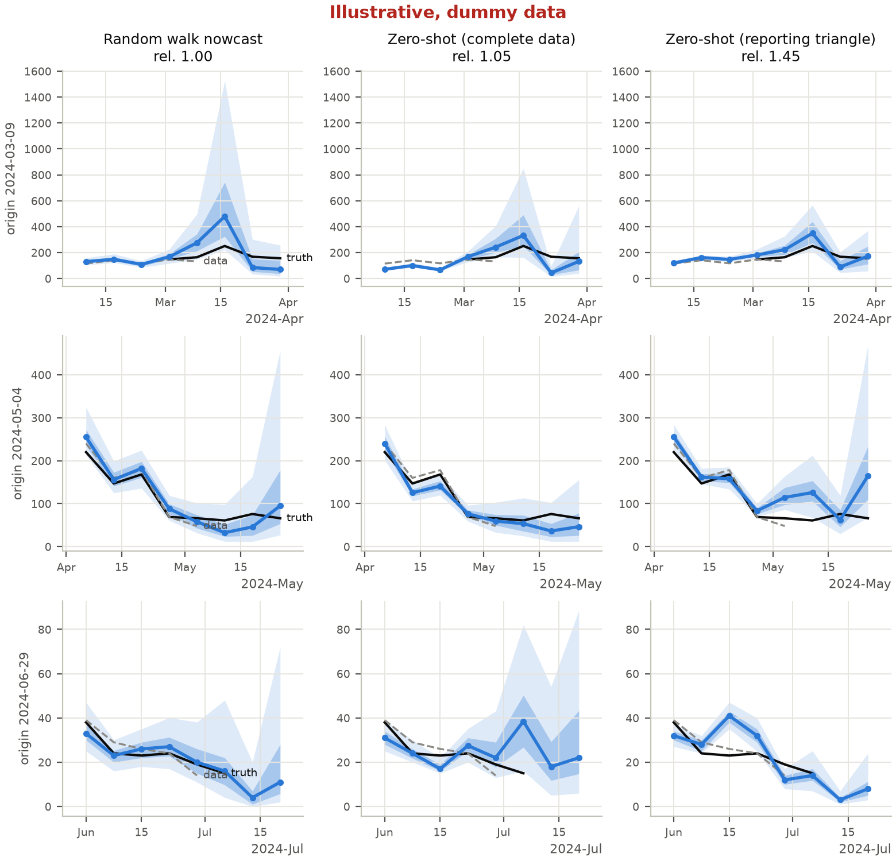

Held-out synthetic data: nowcasts of one held-out outbreak, drawn with the workflow's seed, one column per model and one row per origin. Black is the rolling truth, grey dashed the data as of the origin, and blue the model's median with its 50% and 90% intervals; each column gives the model's score relative to `randomwalknowcast`.  
:::

::: {#tbl-synthetic-scores}


Held-out synthetic data: mean scores, coverage and number of forecasts of each model, with scores relative to  on the forecasts both made, and each model's pairwise relative skill against every other model on the natural and log scales, scaled to the same model.  
:::

::: {#tbl-synthetic-evaluated}


The share of evaluated outbreaks in each level of each grid factor, as each simulation recorded its cell.  
:::

::: {#fig-synthetic-si-nowcasts}
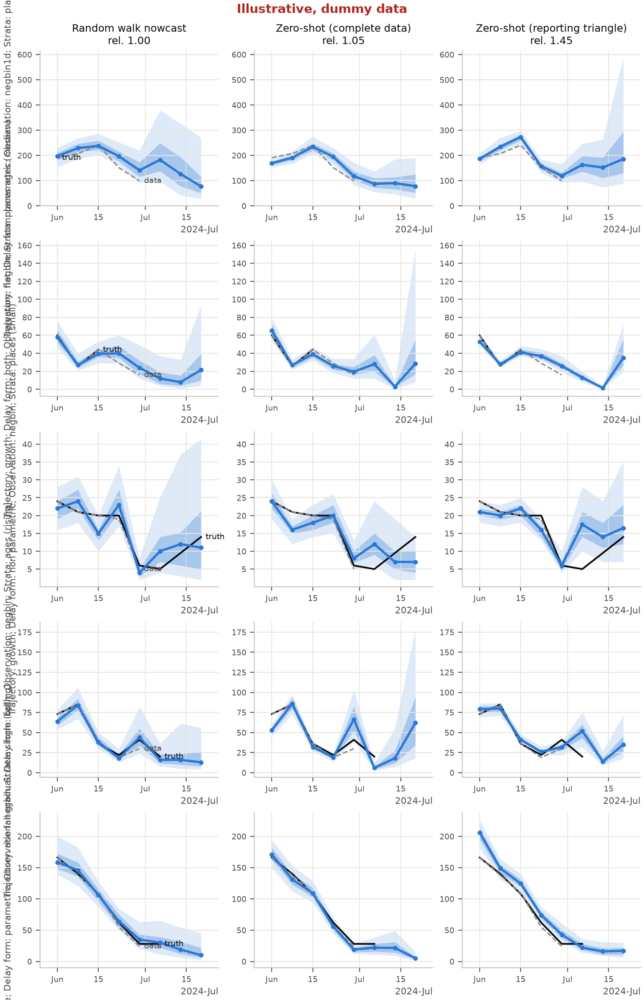

Held-out synthetic data: nowcasts of outbreaks drawn to cover the levels of the trajectory, delay form, observation model and strata, one row per outbreak labelled by its cell, one column per model. Black is the rolling truth, grey dashed the data as of the origin, and blue the model's median with its 50% and 90% intervals.  
:::

::: {#fig-synthetic-si-factors}
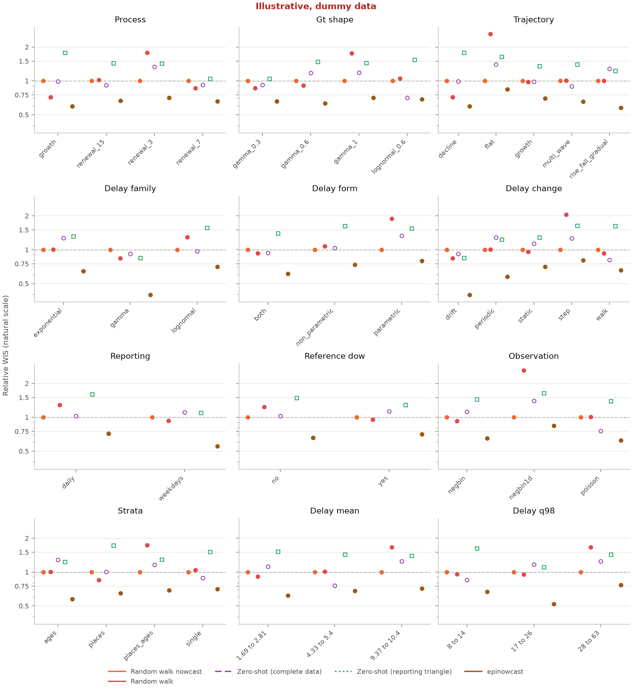

Held-out synthetic data: relative WIS by level of each scenario factor.  
:::

::: {#fig-synthetic-si-factors-log}
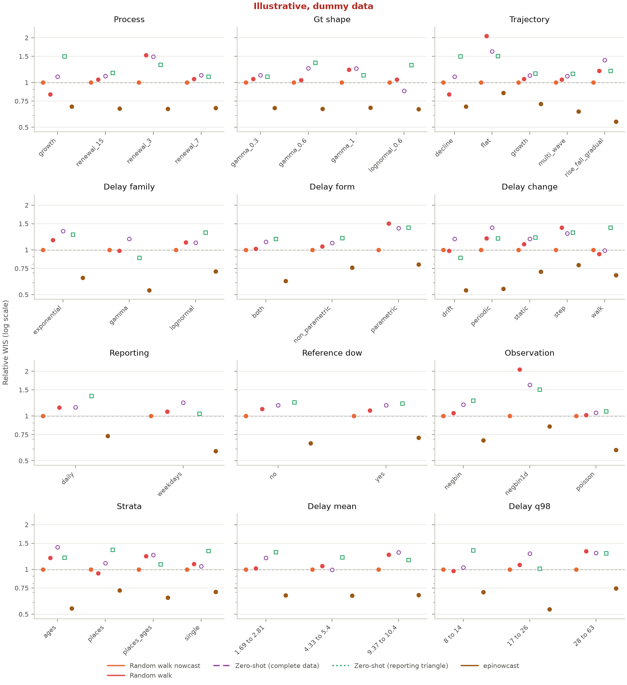

Held-out synthetic data: relative WIS on the log scale by level of each scenario factor.  
:::

::: {#fig-synthetic-si-wis-over-time}
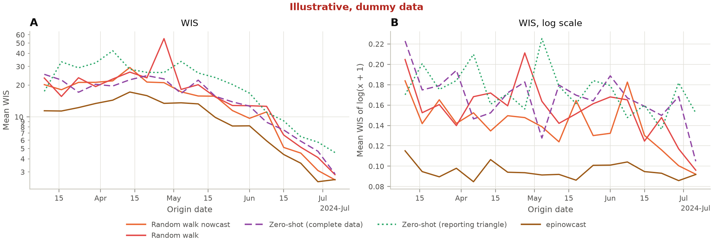

Held-out synthetic data: WIS over time.  
:::

::: {#fig-synthetic-si-results-crps}
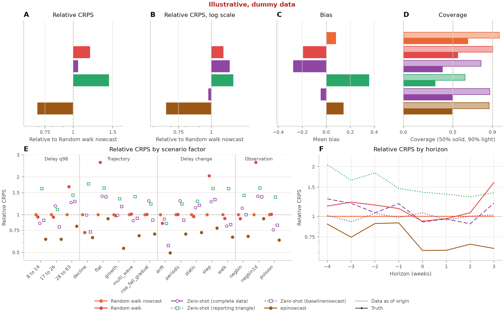

Held-out synthetic data: the main results figure for every model that gives samples, scoring the samples by the fair CRPS rather than the WIS of their quantiles. (A, B) CRPS relative to `randomwalknowcast` on the natural and log scales; (C) bias; (D) 50% and 90% coverage; then relative CRPS by scenario factor and by horizon.  
:::

::: {#tbl-synthetic-horizon}


Held-out synthetic data scores by horizon.  
:::

::: {#tbl-synthetic-location}


Held-out synthetic data scores by location and stratum.  
:::

### German nowcast hub

::: {#fig-germany-nowcasts}
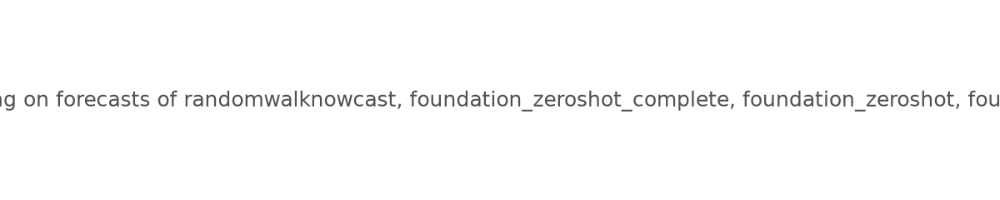

German nowcast hub: national nowcasts, one column per model and one row per origin. Black is the rolling truth, grey dashed the data as of the origin, and blue the model's median with its 50% and 90% intervals; each column gives the model's WIS relative to `randomwalknowcast`.  
:::

::: {#tbl-germany-scores}


German nowcast hub: mean scores, coverage and number of forecasts of each model, with scores relative to  on the forecasts both made, and each model's pairwise relative skill against every other model on the natural and log scales, scaled to the same model.  
:::

::: {#fig-germany-si-nowcasts}

German nowcast hub: nowcasts for places picked by a rule in the workflow config (the largest, median and smallest by recent count, and the most rising and most falling), one row per place labelled with why it was picked, at the last origin shown in the main text, one column per model. Black is the rolling truth, grey dashed the data as of the origin, and blue the model's median with its 50% and 90% intervals.  
:::

::: {#fig-germany-si-places}
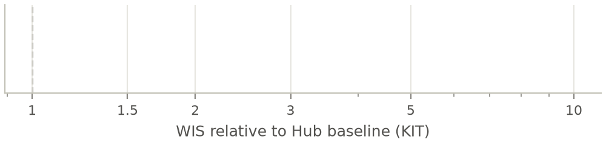

German nowcast hub: WIS of every place relative to , one dot per model.  
:::

::: {#fig-germany-si-location-horizon}
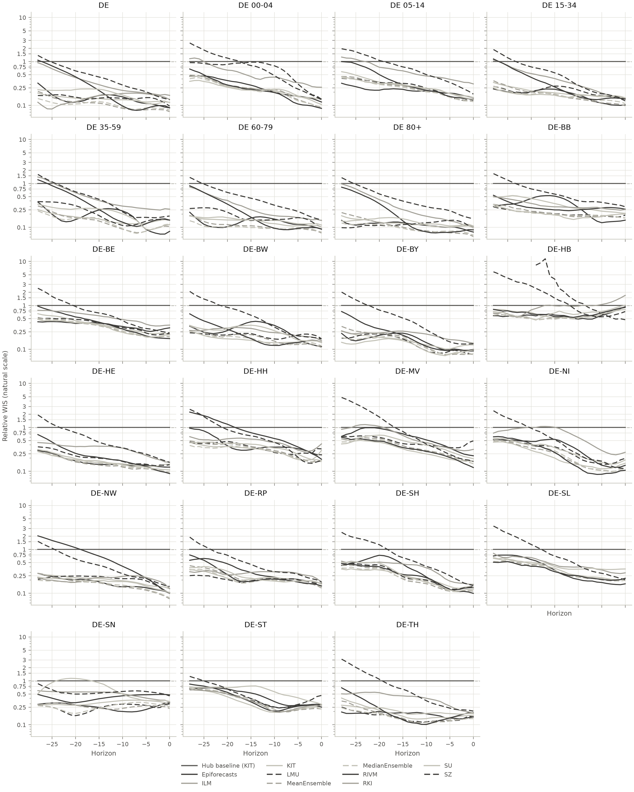

German nowcast hub: relative WIS by location and horizon, on the hub's targets only.  
:::

::: {#fig-germany-si-location-horizon-log}
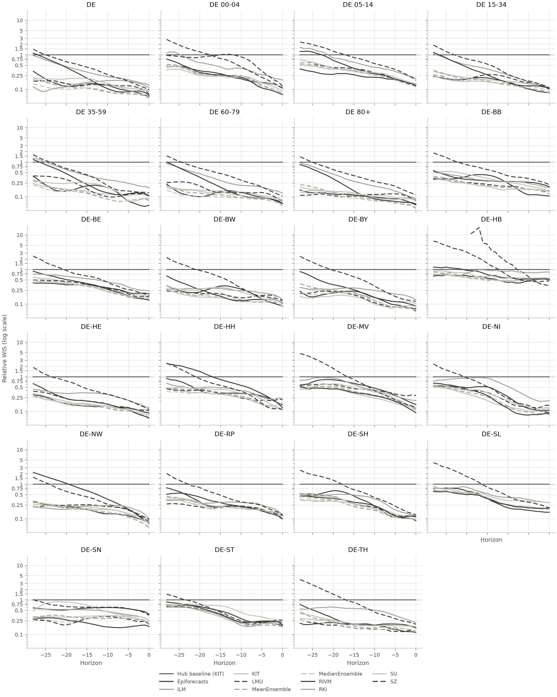

German nowcast hub: relative WIS on the log scale by location and horizon, on the hub's targets only.  
:::

::: {#fig-germany-si-wis-over-time}
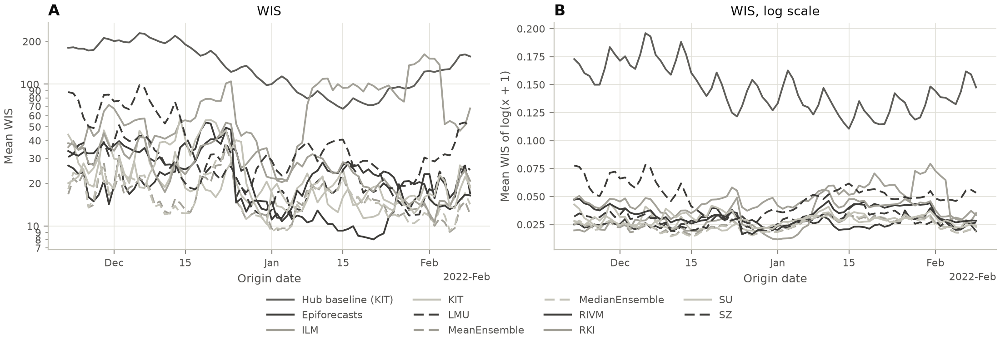

German nowcast hub: WIS over time, with a dotted line at the split.  
:::

::: {#tbl-germany-horizon}


German nowcast hub scores by horizon, on the hub's targets only.  
:::

::: {#tbl-germany-location}


German nowcast hub scores by location and stratum.  
:::

### Ebola hub submissions

::: {.callout-note title="Plan"}
- Active zones have forecasts from both the active and the by-province blocks.
- We compare their scores pairwise on the same zones and weeks, as WIS on natural and log scales by horizon.
- This shows what the active block adds for a zone over its province's block.
- The hub model `seabbs-renewal` (Renewal model) scored [X] against the other hub submissions, and submitted `renewalbvd` in [X] of [X] rounds.
:::

::::: {.content-visible when-meta="results.ebola.shown"}

::: {#fig-ebola-nowcasts}

Ebola: national nowcasts, one column per model and one row per origin. Black is the rolling truth, grey dashed the data as of the origin, and blue the model's median with its 50% and 90% intervals; each column gives the model's WIS relative to `randomwalknowcast`.  
:::

::: {#tbl-ebola-scores}


Ebola hub submissions: mean scores, coverage and number of forecasts of each model, with scores relative to  on the forecasts both made, and each model's pairwise relative skill against every other model on the natural and log scales, scaled to the same model.  
:::

::: {#tbl-ebola-joint}


Ebola hub submissions: mean energy score of each model's trajectories on log(x + 1) counts, and their ratio to  on the forecasts both made.  
:::

::: {#fig-ebola-si-nowcasts}

Ebola: nowcasts for places picked by a rule in the workflow config (the largest, median and smallest by recent count, and the most rising and most falling), one row per place labelled with why it was picked, at the last origin shown in the main text, one column per model. Black is the rolling truth, grey dashed the data as of the origin, and blue the model's median with its 50% and 90% intervals.  
:::

::: {#fig-ebola-si-places}

Ebola: WIS of every place relative to , one dot per model.  
:::

::: {#fig-ebola-si-location-horizon}

Ebola: relative WIS by location and horizon.  
:::

::: {#fig-ebola-si-location-horizon-log}

Ebola: relative WIS on the log scale by location and horizon.  
:::

::: {#fig-ebola-si-wis-over-time}

Ebola: WIS over time.  
:::

::: {#fig-ebola-si-results-crps}

Ebola: the main results figure for every model that gives samples, scoring the samples by the fair CRPS rather than the WIS of their quantiles. (A, B) CRPS relative to  on the natural and log scales; (C) bias; (D) 50% and 90% coverage; then relative CRPS by location and by horizon.  
:::

::: {#tbl-ebola-horizon}


Ebola hub submissions scores by horizon.  
:::

::: {#tbl-ebola-location}


Ebola hub submissions scores by location and stratum.  
:::

:::::

### Checkpoint curve

- We compare the final run's checkpoints, fine-tuned on  simulations.
- They share the grid, the data order and the recipe, as checkpoints of one run.
- @fig-progress-finetuned gives its progress over the checkpoints, in the panels every run's progress figure has.
- Its loss panel gives the trainer's training loss and the validation loss by source and by level, for transparency, not to select a checkpoint.
- Its German panels give development-period relative scores at each checkpoint on every horizon, the nowcasts and the forecasts, with zero-shot Chronos-2 on the reporting-triangle layout and on complete data as reference lines.
- Its 7-day panel gives the 7-day check, and in a paper run its BDBV panel gives the BDBV check, at each checkpoint.
- @tbl-checkpoints gives the headline scores of each checkpoint, and @tbl-live-summary the newest scored checkpoint against zero-shot Chronos-2.
- A later checkpoint has also trained for more steps.
- The learning rate falls linearly to zero over the  simulations, so the earlier checkpoints are taken at  () to  () of the starting rate, and only the  checkpoint is annealed.

![Progress of the fine-tuned model's run (`finetuned`) over its checkpoints. Loss: the trainer's training loss (a rolling mean of 50 logged steps), the validation loss by source at each evaluated step and by level (markers) at the start and at each checkpoint, against training step, with each checkpoint's simulations marked. 7-day check: the 7-day row's median over the 7-day sums of the daily medians, the share of those sums inside the row's 90% interval, and the roughness of its median over the truth's, each with its target dashed. BDBV check: relative CRPS against `randomwalknowcast` on the hub's releases, in a paper run only. German rows: WIS (on each model's own quantiles) relative to `randomwalknowcast` by level, on every horizon, the nowcasts (days 0 and before) and the forecasts (days after), with zero-shot Chronos-2 on the reporting-triangle layout (dashed) and on complete data (dotted) and `randomwalknowcast` at 1. Each German panel gives n, the fewest matched cells of its points, and the forecast origins they come from. Panels without rows say so.  Development data only.](build/figures/si/progress-finetuned.png){#fig-progress-finetuned}

::: {#tbl-live-summary}


Zero-shot Chronos-2 and the newest scored checkpoint of the fine-tuned model: national WIS on the German development period, relative to `randomwalknowcast` (daily / weekly model), and the trainer's validation loss, with each cell's simulations in brackets. @tbl-checkpoints gives every checkpoint.  Development data only.
:::

::: {#tbl-checkpoints}


Zero-shot Chronos-2, then each checkpoint by the simulations it was fine-tuned on: national WIS on the German development period, relative to `randomwalknowcast` (daily / weekly model), and the trainer's validation loss. Blank cells are not yet scored.  Development data only.
:::

### Daily nowcasts

- We score our models' daily counts in both case studies directly from the daily rows, not summed.
- The main text scores the hub targets, 7-day counts for Germany and weekly counts for BDBV.
- Hub teams give no daily forecasts, and `randomwalknowcast` forecasts the 7-day sums only, so for Germany we compare daily counts with zero-shot Chronos-2 on the reporting-triangle layout.
- For Germany, the daily zero-shot and fine-tuned models' block has each place's rolling 7-day sum row, so one call gives the daily counts and the hub's 7-day sums for every day.
- We score the hub targets on the rolling rows and the daily counts on the daily rows, with no summing of daily draws.
- The two outputs come from one call and are not forced to agree.
- @fig-compare-daily shows both.
- @fig-germany-si-results-daily repeats the German results figure for daily counts.

{#fig-compare-daily}

::: {#fig-germany-si-results-daily}

German nowcast hub, daily counts: the score panels of the German results figure, on daily counts relative to `randomwalknowcast`, without the hub teams or the nowcast panel.  
:::

### Real-data fine-tune against synthetic

- We fine-tune a model on the German development period and BDBV releases, and compare it with the model fine-tuned on simulations.
- Its BDBV training data are every release up to , so we score it only on held-out Ebola rounds after that release.
- It saw the German development period, so we score it on the test period only.
- Both use the same recipe and the reporting-triangle layout.
- @tbl-real-finetune gives the scores, and @fig-compare-realdata shows them.
- @fig-progress-realdata gives the real-data run's own progress, in the panels of @fig-progress-finetuned.
- We leave the real-data model out of every other table and figure.

{#fig-compare-realdata}

{#fig-progress-realdata}

::: {#tbl-real-finetune}


Chronos-2 zero-shot (`foundation_zeroshot`), fine-tuned on simulations (`foundation`) and fine-tuned on real data (`foundation_real`), by level: WIS on the German test period and on held-out Ebola rounds after the real-data model's last training release, relative to `randomwalknowcast`. Blank cells have no scores yet.
:::

### Attention bias setups

- We compare four attention bias setups: all three biases (the fine-tuned model), no biases, the same-place bias only, and the parent and child biases only.
- All four runs share the grid, the data order, the LoRA recipe and the checkpoints.
- @fig-compare-nobiases shows the trainer's validation loss and German development-period relative scores of each run by checkpoint and level.
- @fig-progress-nobiases, @fig-progress-sameplace and @fig-progress-parentchild give each other run's own progress, as @fig-progress-finetuned does for the fine-tuned model.
- @tbl-slots-summary gives each run's scores at its final checkpoint.
- The lag-swap test moves whole lag series to another place.
- A ratio above 1 means the model's forecast depends on which place's lags sit with a target.
- Zero-shot Chronos-2 can also match lags to targets by value, so the comparison with the run without biases, not the ratio alone, tests the biases.
- The lag-swap test is not yet scored for this run.

{#fig-progress-nobiases}

{#fig-progress-sameplace}

{#fig-progress-parentchild}

{#fig-compare-nobiases}

::: {#tbl-slots-summary}


Zero-shot Chronos-2 and the newest checkpoint of each attention bias setup: national WIS on the German development period, relative to `randomwalknowcast` (daily / weekly model), and the trainer's validation loss, with each cell's simulations in brackets.  Development data only.
:::

### Delays against no delays

- We fine-tune a run on complete counts only, with the attention biases and without delay information, and compare it with the reporting-triangle run.
- Both runs share the grid, the data order, the recipe and the checkpoints.
- @fig-compare-nodelays shows both runs by checkpoint.
- @fig-progress-nodelays gives the no-delay run's own progress.
- Without delay information the no-delay model has no counts after the last complete step, so its context ends there.

{#fig-compare-nodelays}

{#fig-progress-nodelays}

### Impact of correlated trajectories

- @fig-copula-impact compares the rolling $\rho_p$ with no pairing on the Ebola hub, at the national level and for provinces.
- The per-province CRPS and coverage are unchanged by construction, so only the national sum and the energy score move.
- The median rolling $\rho_p$ between provinces is  for `randomwalknowcast` and  for `randomwalk`, with  and  nowcasts falling back to the prior.

{#fig-copula-impact}

### Renewal model variants

::: {.callout-note title="Plan"}
- We score `renewal`, `renewalbvd` and `renewalsp` on every Ebola hub round, retrospectively, from the fits each made with the release before the round closed (Renewal model).
- The fits and scores come from the submission workflow's stored fits and hub comparison, not from the paper workflow, as the renewal models were only used for submission.
- `renewalbvd` against `renewal` shows whether stabilising with BVDOutbreakSize's reproduction number estimates improved the forecasts [@BVDOutbreakSize].
- `renewal` against `renewalsp` shows what pooling and transmission between places add.
- We compare them by pairwise relative skill on the forecasts each pair shares, with WIS on the natural and log scales, for the country, provinces and zones apart, as in the Ebola case study.
- Results to be filled in: `renewalbvd` scored [X] relative to `renewal`, and `renewal` [X] relative to `renewalsp`.
:::

## References {.unnumbered}
